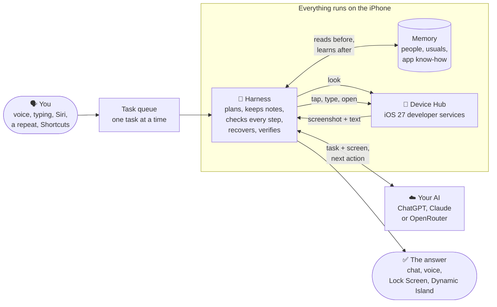
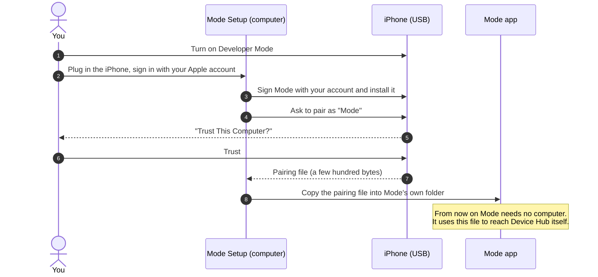
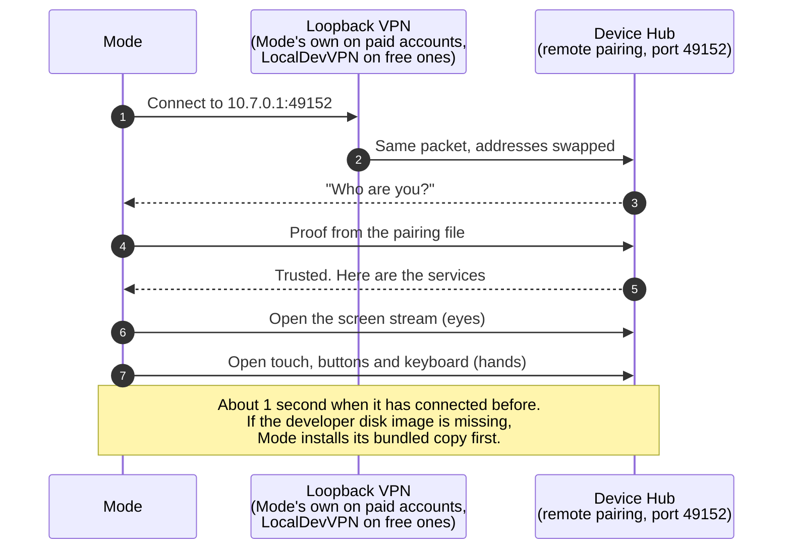
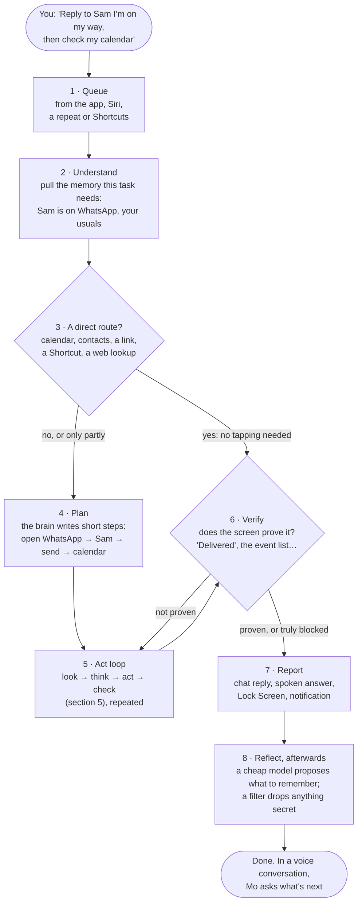
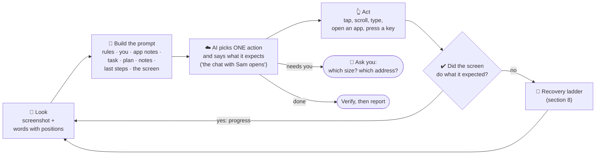
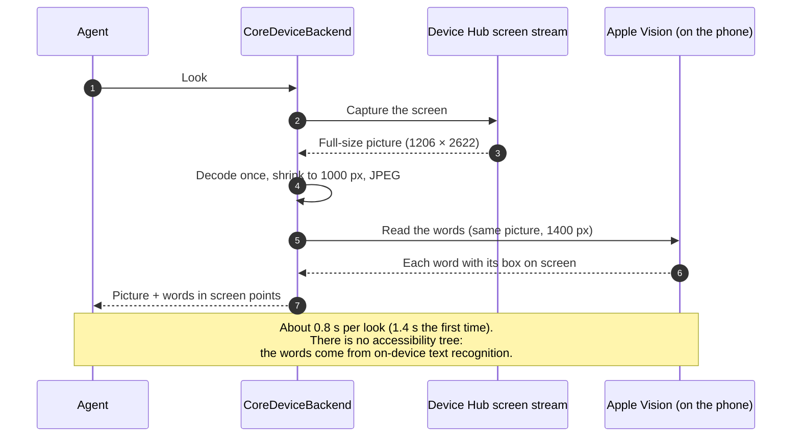
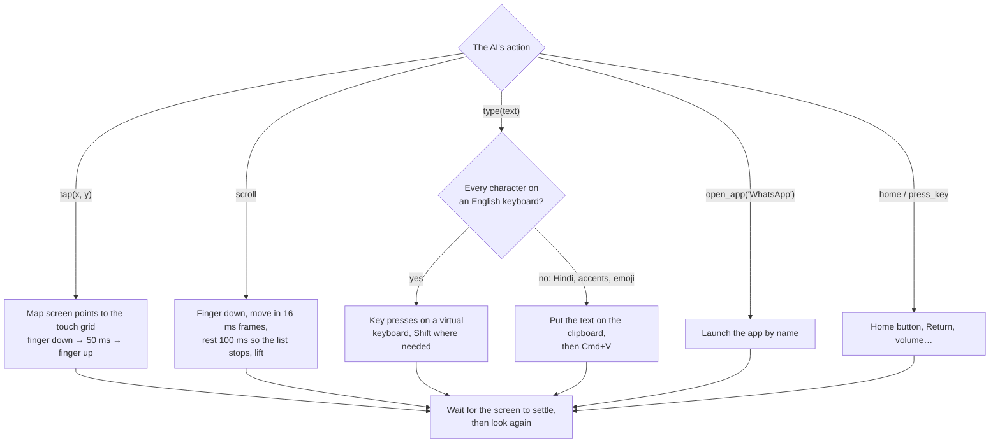
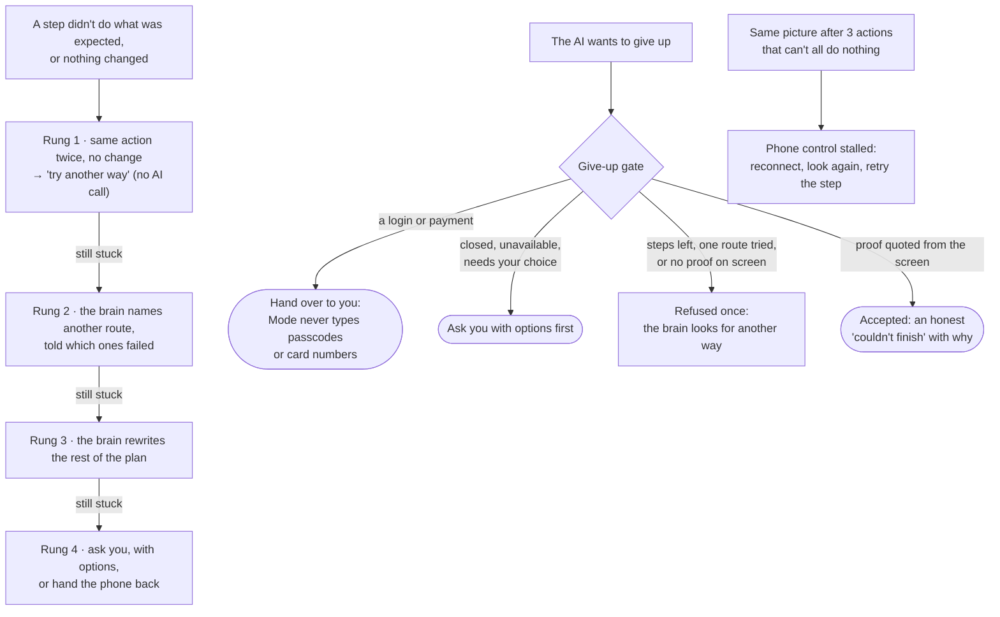
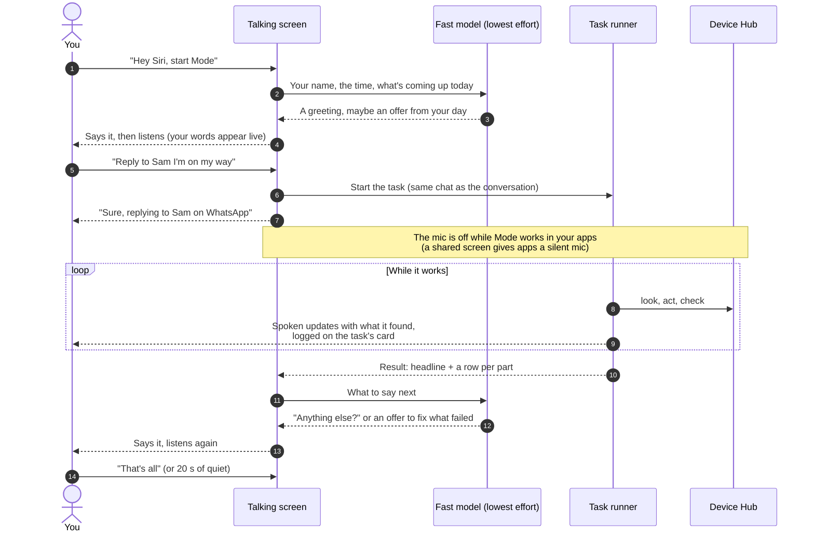
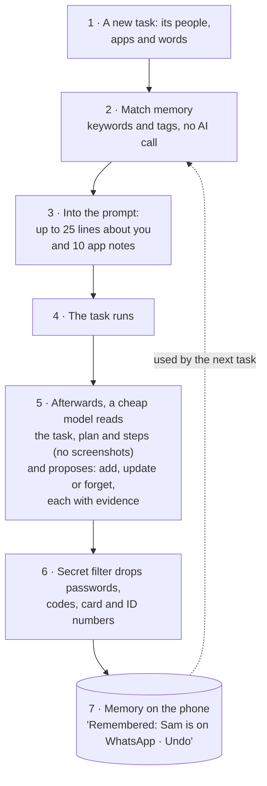

# Mode for developers

What actually happens inside Mode when you say *“Text Sam I’m on my way”*, how it
sees the screen and taps, how it keeps going when things go wrong, and how to build
it yourself. If you want to send a change, read [CONTRIBUTING.md](CONTRIBUTING.md) too.

**Contents**
1. [The big picture](#1-the-big-picture)
2. [Setup, once: pairing with Device Hub](#2-setup-once-pairing-with-device-hub)
3. [Connecting: how Mode reaches its own iPhone](#3-connecting-how-mode-reaches-its-own-iphone)
4. [One task, start to finish](#4-one-task-start-to-finish)
5. [One step: look, think, act, check](#5-one-step-look-think-act-check)
6. [Seeing the screen](#6-seeing-the-screen)
7. [Tapping, scrolling and typing](#7-tapping-scrolling-and-typing)
8. [When something goes wrong](#8-when-something-goes-wrong)
9. [Talking: Hey Siri, start Mode](#9-talking-hey-siri-start-mode)
10. [Memory: how Mode learns you](#10-memory-how-mode-learns-you)
11. [Where everything lives](#11-where-everything-lives)
12. [Build from source](#12-build-from-source) · [Tests](#13-tests) · [Releasing](#14-releasing) · [More documents](#15-more-documents)

---

## 1. The big picture

Mode is an app on your iPhone that drives your iPhone. It has **eyes** (a picture of
the screen plus the words on it), **hands** (taps, swipes, typing, opening apps) and a
**brain** (the AI you connected). Nothing in Mode knows how WhatsApp or Settings work:
the AI decides every step from your task and what is on the screen.



There is no Mode server. The only things that leave the phone are the task, the
current screen and a few memory lines (to the AI you chose) and your voice (to the
voice service you chose; Apple’s stays on the phone).

---

## 2. Setup, once: pairing with Device Hub

iOS 27 has **Device Hub**: Apple’s developer services (CoreDevice) that let a trusted
computer watch the screen and send touches, for testing apps. Mode uses those same
services, but from the phone itself. For that, the phone must trust Mode once, and
the iPhone only creates that trust **over a USB cable from a computer**. Mode Setup
does it (Mac today; the same code builds for Windows and Linux).



The pairing file is lost if Developer Mode is turned off, the phone’s trust settings
are reset, or you tap **Stop Session** on the Dynamic Island during a task. Then
Mode Setup pairs again.

*Code:* `desktop/` (Mode Setup, Rust + Tauri, on isideload and idevice),
`native/modecore` (`pair_over_usb`).

---

## 3. Connecting: how Mode reaches its own iPhone

Device Hub refuses connections that start on the phone itself. It wants a
“computer”. So Mode runs a tiny **loopback VPN** that sends its own packets straight
back to the phone with the sender and receiver swapped. Device Hub then sees a
connection from another address, checks the pairing file, and accepts it.



While a task runs, Mode plays silent audio so iOS keeps it awake while another app is
in front; otherwise the phone drops the idle connection. When the task ends, Mode
closes the connection so the microphone works again (iOS gives an app a silent
microphone while the screen is being shared).

*Code:* `engine/phone-ios/.../PhoneConnector.kt`, `LoopbackVpn.kt`,
`ModecoreSession.kt`, `iosApp/ModeTunnel/PacketTunnelProvider.swift`,
`feature/connection/.../PhoneSession.kt`.

---

## 4. One task, start to finish



- **One phone, one task at a time.** Tasks from every source wait in one queue.
- **Two minds.** A fast *phone-control* model picks each action. A stronger *brain*
  writes the plan and is consulted when Mode is stuck or about to give up.
- **Direct routes first.** If the answer is in the calendar, contacts, a web lookup
  or a Shortcut, Mode uses that instead of tapping through screens. The calendar is
  treated as Google Calendar unless you name another one.
- **Stops:** a step budget that grows with progress, a cost limit (OpenRouter), being
  stuck after every recovery idea, 15 minutes, or your Stop. Each ends with an honest
  summary of how far it got.

*Code:* `feature/tasks/.../TaskQueue.kt`, `TaskRunner.kt`, `engine/agent/Agent.kt`,
`Brain.kt`, `engine/ops/DeviceData.kt`, `feature/memory/.../Reflector.kt`.

---

## 5. One step: look, think, act, check

Every step of the act loop is the same small cycle. A step takes about 3–5 seconds:
around 1 s to look, 1–3 s for the AI, around 1 s to act and let the screen settle.



**What the AI sees each step** is built in fixed sections, most stable first, so
providers that cache prompts can reuse most of it:

| # | Section | Changes |
|---|---|---|
| 1 | Rules and iOS know-how | Never |
| 2 | The tools it may call | Never |
| 3 | About you: matching memory, your name | Per task |
| 4 | Notes for the apps in this task | Per task |
| 5 | Earlier tasks in this chat | Per task |
| 6 | The task, your answers, the plan | Rarely |
| 7 | Facts it noted on the way (“flight 6E223”) | Grows, capped |
| 8 | The last 12 steps, earlier ones summarised | Every step |
| 9 | The screen: picture + up to 80 words with positions | Every step |

*Code:* `engine/agent/ContextBuilder.kt`, `AgentTools.kt`, `ExpectCheck.kt`,
`StepBudget.kt`.

---

## 6. Seeing the screen



The AI gets both: the picture (to understand the layout) and the words with exact
positions (so a tap on “Send” lands on Send). A picture taken before the last action
is never reused.

*Code:* `engine/phone-ios/.../CoreDeviceBackend.kt`, `VisionTextReader.kt`.

---

## 7. Tapping, scrolling and typing



Touches are timed with the phone’s own clock (`mach_absolute_time`): wall-clock times
make iOS drop taps. Touches are only accepted while Mode’s screen stream is open,
which is why the eyes connect first.

*Code:* `native/modecore` (Rust, over idevice), `engine/phone-ios/.../ModecoreSession.kt`.

---

## 8. When something goes wrong

Most failures come from the harness, not the AI, so the harness fights to finish
before it gives up:



Orders, payments, bookings and sends are **checked twice**: the amounts go into notes
before the final tap, and success needs proof on screen (an order number, an ETA,
“Delivered”). Seeing the same button again means it didn’t go through.

*Code:* `engine/agent/RecoveryLadder.kt`, `GiveUpGate.kt`, `StuckDetector.kt`,
`ChangeLedger.kt`, `Playbook.kt`.

---

## 9. Talking: Hey Siri, start Mode

A spoken session is one conversation: one task after another until you say “that’s
all” or go quiet.



*Code:* `app/screens/.../settings/ListenPresenter.kt`, `feature/memory/.../Greeter.kt`,
`Acknowledger.kt`, `feature/tasks/.../Narrator.kt`, `iosApp/Mode/Features/Talk/Talk.swift`.

---

## 10. Memory: how Mode learns you



| Kind | Example |
|---|---|
| About you | “Sam: message on WhatsApp”, “messages short and casual” |
| How to do it, per app | “Settings: search ‘Dark Mode’ goes straight there” |
| Usuals | “Usual coffee: Oat Latte, Large, to the office” |
| What happened | Past runs, searchable |

You can see, edit and forget everything in Settings → What Mode knows about you.
Backup and restore carries memory to a new phone in one file (encrypted when it
includes your sign-ins).

*Code:* `feature/memory/` (`MemoryRetrieval.kt`, `Reflector.kt`),
`feature/tasks/.../TaskMemory.kt`, `feature/backup/`.

---

## 11. Where everything lives

| Part | Built with | Where |
|---|---|---|
| Agent, harness, memory, queue, schedules, model clients, voice | Kotlin Multiplatform, shared with the coming Android app | `core/` → `engine/` → `feature/` → `app/` |
| Screens’ logic (state, decisions) | Kotlin presenters, tested on the JVM | `app/screens` |
| The iPhone app, Live Activity, Siri | SwiftUI, App Intents, ActivityKit; views only draw state | `iosApp/` |
| Design system (tokens and components only) | Swift package | `iosApp/Packages/ModeDesignSystem` |
| Eyes and hands over Device Hub | Rust on [idevice](https://github.com/jkcoxson/idevice) | `native/modecore` |
| The loopback VPN (paid accounts) | Network Extension | `iosApp/ModeTunnel` |
| Mode Setup for Mac, Windows and Linux | Rust and Tauri, on [isideload](https://github.com/nab138/isideload) | `desktop/` |

The Kotlin layers only depend downwards (`core → engine → feature → app`);
`./gradlew checkModuleRules` enforces it.

| Measured on an iPhone 17 Pro | Time |
|---|---|
| Connect to Device Hub (after the first time) | ~1 s |
| One look: picture + words | ~0.8 s (1.4 s first) |
| Open an app by name | ~0.15 s |
| One step: look + AI + act | 3–5 s |

---

## 12. Build from source

You’ll need a Mac with Xcode 27.1+, XcodeGen (`brew install xcodegen`), Rust via
rustup, an iPhone on iOS 27+ with Developer Mode on, and an Apple account (free or
paid). The full walkthrough, including pairing and the free-account VPN, is in
[docs/setup.md](docs/setup.md).

```sh
cp iosApp/Signing.example.env iosApp/Signing.env   # then put in your team and app ID prefix
tools/gen-project.sh paid             # or: free (generates iosApp/Mode.xcodeproj)
./gradlew jvmTest checkModuleRules    # shared Kotlin tests and module rules
sh tools/check-ui-literals.sh         # screens use design-system tokens only
open iosApp/Mode.xcodeproj            # build and run on your iPhone
cd desktop && cargo build             # Mode Setup (Rust + Tauri)
```

`iosApp/Signing.env` is git-ignored, so your team and app ID never end up in a pull
request.

## 13. Tests

- `./gradlew jvmTest` runs the shared Kotlin tests: the agent, memory, queue,
  presenters and backup. They use fakes for the phone and the AI, so they need no device.
- `./gradlew checkModuleRules` checks the module layering.
- `sh tools/check-ui-literals.sh` fails on literal colours, sizes, fonts or strings in
  screens. It also runs as an Xcode build phase.
- `node --test desktop/setup-app/tests/phone-setup.test.cjs` and `cargo test` cover Mode Setup.
- [docs/eval-suite.md](docs/eval-suite.md) is the on-phone suite of real tasks used to
  judge the agent.

## 14. Releasing

Mode and Mode Setup are released separately, each with its own version and changelog.

| | Mode (the phone app) | Mode Setup (the desktop app) |
|---|---|---|
| Tag and title | `Mode-Mobile-Build-<version>` | `Mode-Desktop-App-<version>` |
| Version in | `iosApp/project.yml` (`MARKETING_VERSION`) | `desktop/setup-app/tauri.conf.json`, `desktop/Cargo.toml` |
| Changelog | `CHANGELOG.md` | `desktop/CHANGELOG.md` |
| Release | `tools/release-app.sh <version>` | `tools/release-setup.sh <version>` |
| Holds | `Mode.ipa`, `Mode-paid.ipa` (and `mode-android.apk` for Android) | the Mac `.dmg`; CI adds Windows and Linux |
| Publish | `gh release edit Mode-Mobile-Build-<v> --draft=false --latest` | `gh release edit Mode-Desktop-App-<v> --draft=false --latest=false` |

- Versions count 0.1.8, 0.1.9, 0.2.0: three single digits, so a part never reaches 10 (0.2.0
  follows 0.1.9, never 0.1.10). The scripts refuse anything else.
- Each script stops before building if the version doesn't match or its changelog has no
  section for it. The section becomes the release's "What's new" (`tools/release-notes.sh`).
- A Mode release is GitHub's "Latest". Mode Setup finds the newest Mode by its tag, installs it
  on every install, reinstall and renewal, and offers it as an update. No new Mode Setup is
  needed for a new Mode.
- A Mode Setup release carries the newest published Mode inside it
  (`tools/latest-app-release.sh`), so it installs offline too.
- heymode.app's download links serve the newest Mode Setup release (`website/worker`).

## 14b. Android

The Android app is `app/android` (Compose over the same shared presenters as the iPhone), its design
library `app/design`, and the engine `engine/phone-android` (Mode's accessibility service). Background
mode adds `engine/adb-link` and `engine/adb-helper`. Everything, from setup to background mode, is in
[docs/android.md](docs/android.md).

```sh
./gradlew :app:android:installFullDebug      # onto a phone or emulator with USB debugging
tools/build-apk.sh                           # a release APK into dist/ (signing: see docs/android.md)
```

Debug builds have an adb probe (`DevProbe`) that drives the engine, posts sample notifications and
walks setup on an emulator; docs/android.md lists its commands.

## 15. More documents

| Document | What it covers |
|---|---|
| [docs/harness.md](docs/harness.md) | The harness in depth: context, memory, budgets, recovery |
| [docs/flows.md](docs/flows.md) | Low-level sequences: pairing, connecting, a look, a tap, typing |
| [docs/coredevice.md](docs/coredevice.md) | The Device Hub services Mode uses, measured timings and gotchas |
| [docs/architecture.md](docs/architecture.md) | Layers, modules, data shapes, threading, build |
| [docs/decisions.md](docs/decisions.md) | Every design decision and why |
| [docs/setup.md](docs/setup.md) | Build, pair, install and test, for paid and free accounts |
| [docs/observability.md](docs/observability.md) | Local OpenTelemetry tracing |
| [docs/status.md](docs/status.md) | What is done and what is next |

Mode has no server. Read [PRIVACY.md](PRIVACY.md) for what leaves the phone and to
whom, and [SECURITY.md](SECURITY.md) to report a vulnerability privately.
