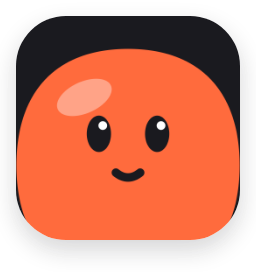
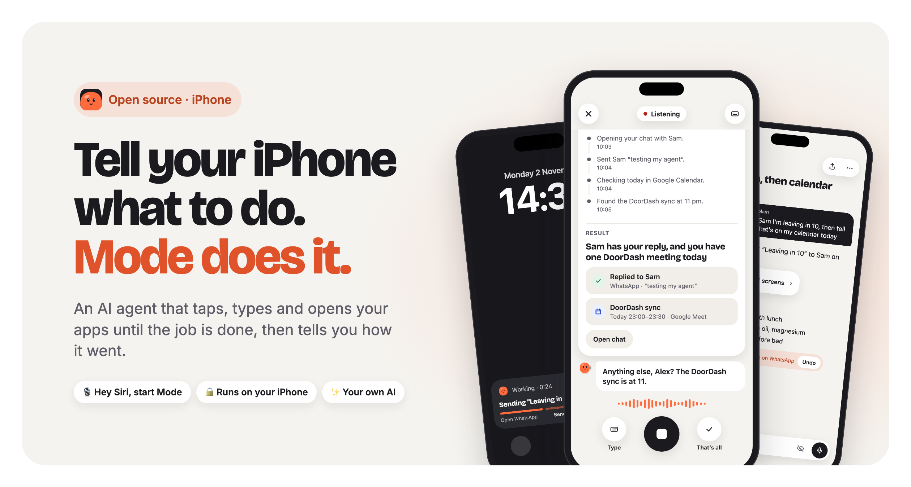
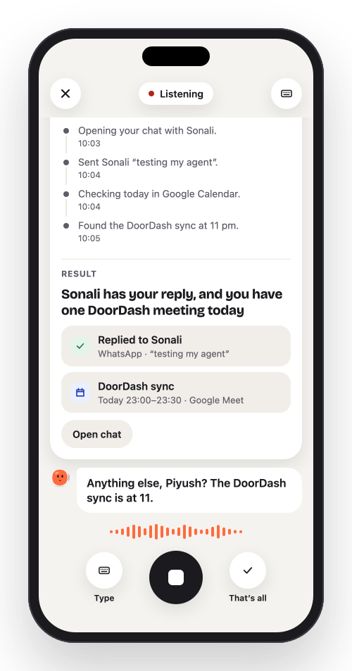
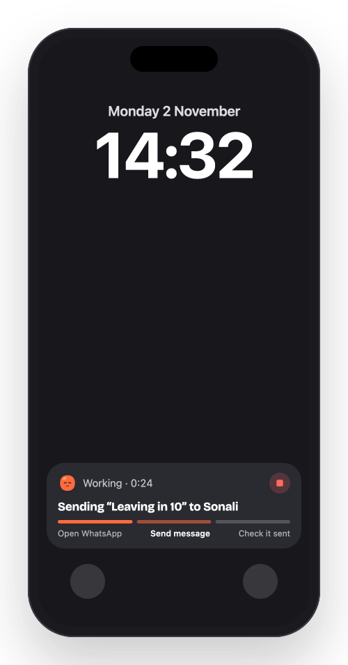
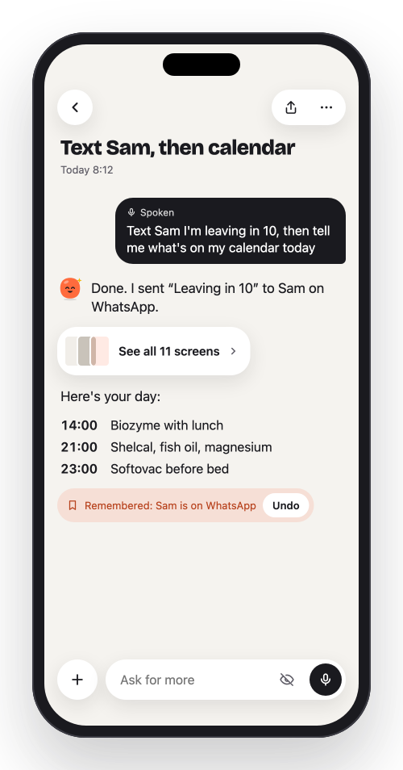
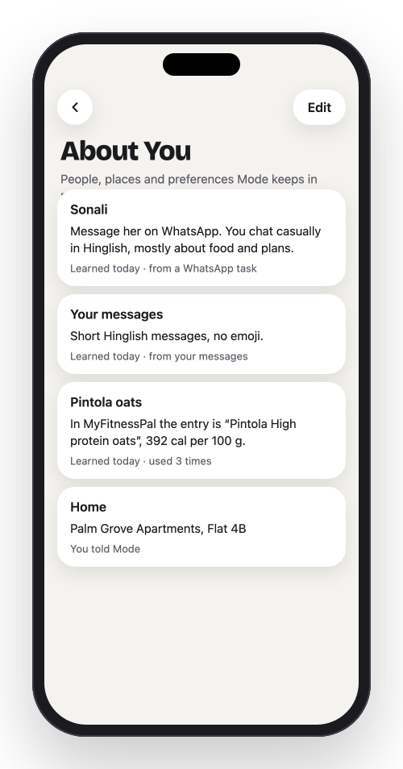
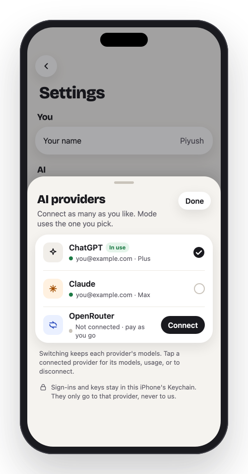
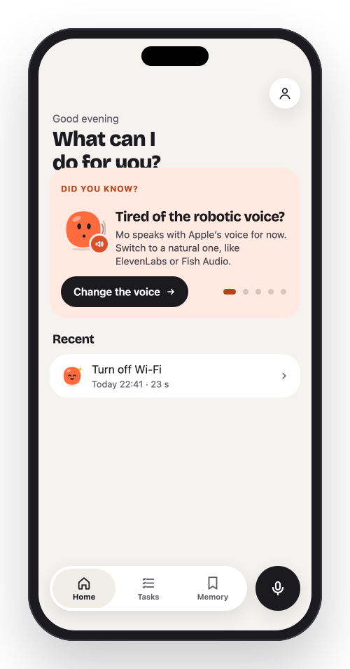

# Mode

### Tell your iPhone what to do. Mode does it in your apps.

An AI agent that lives on your iPhone. Say a task, and Mode taps, types and opens
your apps until it’s done, then tells you how it went.

 

&nbsp;&nbsp;&nbsp;&nbsp;

Free and open source · iPhone on iOS 27 · Your own ChatGPT, Claude or OpenRouter

  

 

## See it in action

> Running late, hands on the wheel: *“Text Sam I’m ten minutes late. Any unread messages?
> Order my usual coffee to the office.”* The iPhone does all three by itself.
> ▶︎ [Watch the full film with sound](https://github.com/Piyusinha/mode/raw/main/docs/media/mode-story.mp4) (71 s) · [the 23-second teaser](https://github.com/Piyusinha/mode/raw/main/docs/media/mode-teaser.mp4)

 

## What Mode can do

<table>
<tr>
<td width="33%" valign="top" align="center">

<h3>Just say it</h3>
“Hey Siri, start Mode.” Ask out loud, hear it answer. When one thing’s done, Mo asks
what’s next. One conversation, as many tasks as you like.
</td>
<td width="33%" valign="top" align="center">

<h3>Watch it work</h3>
Every step shows live on your Lock Screen and in the Dynamic Island, with a Stop
button. You can put the phone down.
</td>
<td width="33%" valign="top" align="center">

<h3>Any app, no setup</h3>
WhatsApp, Calendar, Settings, YouTube, food delivery, your fitness tracker: if you can
do it with your thumbs, Mode can try. Nothing is scripted.
</td>
</tr>
<tr>
<td width="33%" valign="top" align="center">

<h3>It learns you</h3>
Who you text where, your usual order, how you write. Correct it once and it remembers.
See everything it knows, and forget anything.
</td>
<td width="33%" valign="top" align="center">

<h3>Your own AI</h3>
Sign in with your ChatGPT or Claude plan, at no extra cost per task, or bring an
OpenRouter key and pick any model.
</td>
<td width="33%" valign="top" align="center">

<h3>Yours, privately</h3>
No Mode server, no account. Your chats and memory stay on your iPhone, and your keys
stay in its Keychain.
</td>
</tr>
</table>

 

## Things you can say

> 💬 *“Reply to Sam that I’m on my way, on WhatsApp.”* 
> 📅 *“What’s on my calendar today?”* 
> 🌙 *“Turn on Do Not Disturb until 6.”* 
> ☕️ *“Order my usual coffee to the office.”* 
> 📬 *“Read me my unread messages from today.”* 
> ▶️ *“Play the latest Kurzgesagt video on YouTube.”* 
> 🔁 *“Every morning at 8, tell me what’s on my calendar.”*

When Mode needs you (which size, which address, a password only you know), it asks
out loud or on the Lock Screen. Anything it can’t finish, it tells you why, and offers
to try another way.

 

## Get started

<table>
<tr>
<td width="33%" valign="top">

**1 · Download Mode Setup**

[Download Mode installer for Mac](https://heymode.app/download/mac) (or [Windows](https://heymode.app/download/windows), [Linux](https://heymode.app/download/linux)). This downloads **Mode Setup**, a small app that installs Mode on your iPhone for you.

</td>
<td width="33%" valign="top">

**2 · Plug in your iPhone**

Open Mode Setup. It checks your computer first, then asks you to connect your iPhone with a cable. It walks you through each step, signs Mode with your Apple account and installs it. A few minutes, once.

</td>
<td width="33%" valign="top">

**3 · Say hello to Mo**

Open Mode on your iPhone, connect your AI, and give it its first task. Then try *“Hey Siri, start Mode.”*

</td>
</tr>
</table>

**You’ll need:** an iPhone on iOS 27 or later · a computer, once, for setup · a free or paid
Apple account · a ChatGPT or Claude plan, or an OpenRouter key. No Xcode needed.

**On Windows or Linux?** Get [Mode installer for Windows](https://heymode.app/download/windows)
(it needs Apple’s [iTunes from apple.com](https://www.apple.com/itunes/download/win64) for the iPhone driver) or
[for Linux](https://heymode.app/download/linux)
([.deb](https://heymode.app/download/linux-deb); it needs `usbmuxd`).
Mode Setup checks your computer before it starts and tells you if anything is missing.

> **Windows says “Windows protected your PC”?** Mode Setup isn’t signed with a paid Windows
> certificate yet, so SmartScreen doesn’t know it. Click **More info**, then **Run anyway**.
> It’s the same open-source app as on this page, built by GitHub from this repository.

 

## Why isn’t Mode on the App Store?

**Because Apple doesn’t allow it.** App Store apps aren’t allowed to see or tap other apps, and
using your apps for you is exactly what Mode does.

- **So you install it yourself.** Mode uses Apple’s developer tools on your own iPhone, the same
  ones Xcode uses to test apps. Mode Setup signs it with your own Apple account and installs it
  over a cable, once. That’s why setup needs a computer.
- **Nothing is hidden.** Every line of Mode is in this repository, so anyone can read exactly what
  it does. It has no server and no account of its own ([privacy](https://heymode.app/privacy)).
- **Free Apple account? Renew weekly.** Apple asks for apps installed this way to be re-signed
  every 7 days. Mode Setup or SideStore does it for you. A paid developer account lasts a year.

We’re working on an App Store version with the parts Apple does allow, like asking by voice or
Siri, your calendar, reminders and contacts, and Shortcuts. Using your other apps on screen will
stay in this version.

 

## Setting up your iPhone

Mode Setup shows each of these on screen when it’s needed. Here they are in one place.

### Update to iOS 27

Mode sees and taps your screen with Apple’s remote control, which starts in iOS 27, so Mode
Setup stops an iPhone on iOS 26 or earlier. Updating is free and keeps your apps and data.

1. Plug your iPhone into power and connect to Wi-Fi. It takes 20 to 40 minutes and needs about
   7 GB free.
2. Open **Settings → General → Software Update**.
3. Choose **iOS 27**. If the top update is iOS 26, look further down for **Upgrade to iOS 27**
   and tap that.
4. Tap **Update Now** and enter your passcode. Your iPhone restarts and finishes on its own.
5. Plug it into Mode Setup again and press **Check again**.

> **No iOS 27 in Software Update?** Check your iPhone is on
> [Apple’s list of iPhones that get iOS 27](https://www.apple.com/ios/). Not enough space?
> Update with your computer instead: on a Mac, select your iPhone in Finder and click
> **Check for Update**; on Windows, use Apple Devices or iTunes.

### Turn on Developer Mode

Mode uses Apple’s developer tools to see and tap your screen, the same ones app developers
use to test their apps. They only work with Developer Mode on.

1. Plug your iPhone into your computer with Mode Setup open, and tap **Trust** on the iPhone.
   The Developer Mode switch is hidden until a computer shows it, and Mode Setup does that.
2. On your iPhone, open **Settings → Privacy & Security**.
3. Scroll to the bottom, tap **Developer Mode** and turn it on.
4. Tap **Restart**. Keep the cable plugged in.
5. After the restart, unlock your iPhone. When it asks *“Turn on Developer Mode?”*, tap
   **Turn On** and enter your passcode.

Mode Setup notices the restart and carries on by itself.

> **No Developer Mode in Privacy & Security?** Unplug your iPhone, plug it back in with Mode
> Setup open, and tap Trust again. Then close Settings and open it again.

Developer Mode stays on until you turn it off, and it changes nothing else on your iPhone.

### Trust your Apple account

If your iPhone says **“Untrusted Developer”** when you first open Mode:

1. Open **Settings → General → VPN & Device Management**.
2. Tap your Apple account under *Developer App*.
3. Tap **Trust**, then **Trust** again.

This tells your iPhone that you signed Mode yourself. You only do it once per Apple account.

 

## Good to know

Mode is early, and it works around what iPhones normally allow. A few things to expect:

- **Connect on Wi-Fi.** Mode reaches its tools on your iPhone through a small VPN that
  stays on the phone. iOS won’t open that route on mobile data alone, so if you’re away
  from Wi-Fi, turn Mobile Data off for a moment while Mode connects.
- **It uses your VPN slot.** An iPhone runs one VPN at a time, so another VPN (a work
  VPN, Tailscale) pauses while Mode is connected. Your normal internet isn’t affected.
- **Your phone is busy while it works.** Mode taps on your screen, where you can watch,
  so you can’t use the phone for that task’s few seconds. You can stop it or take over
  at any time.
- **Free Apple accounts renew weekly.** Apple asks for apps installed this way to be
  re-signed every 7 days. Mode Setup or SideStore does it for you. A paid developer
  account lasts a year.
- **Some steps are always yours.** Mode never types your passcode, passwords or card
  numbers, and it hands the phone back when one is needed.
- **It isn’t perfect yet.** An app it has never seen can take Mode a few tries, and
  some tasks fail. It tells you why, and it gets better at the apps you use often.

 

## Questions

<b>Is Mode free?</b>

 
Yes. Mode is free and open source. It uses the AI you already pay for (a ChatGPT or
Claude plan), or an OpenRouter key where you pay the provider per use.

<b>Does my phone need to stay plugged into the computer?</b>

 
No. The computer is only for the first install. With a free Apple account, Apple asks for
apps like Mode to be re-signed every 7 days. Mode Setup does that, or you can let
SideStore renew it on the iPhone. With a paid developer account, it lasts a year.

<b>What does Mode send, and to whom?</b>

 
Your task and a picture of the current screen go to the AI you chose, and your voice
to the voice service you chose (Apple’s stays on the iPhone). Nothing goes to us: there
is no Mode server. The details are in <a href="PRIVACY.md">PRIVACY.md</a>.

<b>Can it pay or send things without asking?</b>

 
You decide how much Mode does on its own. It never types your passcode or card
numbers: when a step needs one, it hands the phone back to you.

<b>Android?</b>

 
Coming soon.

 

**Building Mode or curious how it works?** Start with [DEVELOPERS.md](DEVELOPERS.md) and [CONTRIBUTING.md](CONTRIBUTING.md).

Apache License 2.0 · [Privacy](PRIVACY.md) · [Security](SECURITY.md) · [Notices](NOTICE) 
Mode is not affiliated with Apple, OpenAI, Anthropic, OpenRouter or any voice provider. iPhone and iOS are trademarks of Apple Inc.

