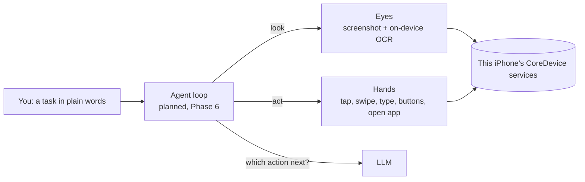

# Mode: documentation

Mode is an iPhone app in which an AI agent does tasks on the phone for you: you
say what you want, and the agent looks at the screen, taps, types and opens
apps until it is done. Everything runs on the phone itself.

This folder records what has been built so far, how it works, and why it was
built this way.

| Document | What it covers |
|---|---|
| [harness.md](harness.md) | How the agent thinks, remembers and stays within budget |
| [status.md](status.md) | What is done, what is pending, and the commit history |
| [telemetry-diagnostics-backup-plan.md](telemetry-diagnostics-backup-plan.md) | Planned cross-platform OpenTelemetry, local diagnostics, and encrypted settings backup |
| [observability.md](observability.md) | Implemented local OpenTelemetry pipeline, coverage, tests, and remaining diagnostics work |
| [architecture.md](architecture.md) | Layers, modules, data shapes, threading, build |
| [flows.md](flows.md) | Sequence and flow diagrams: pairing, connecting, a look, a tap, the hands check, the planned agent loop |
| [decisions.md](decisions.md) | Every design decision, with the options weighed and why one won |
| [research.md](research.md) | The research behind the switch away from XCUITest, with sources |
| [coredevice.md](coredevice.md) | The CoreDevice services Mode uses, measured timings, and gotchas |
| [setup.md](setup.md) | How to build, pair, install and test, for paid and free Apple accounts |

## The idea in one picture

The eyes and hands are built and work on the phone (Phases 0 to 4). The agent
loop is next (Phase 6).

## Two rules that shape everything

1. **Nothing task-specific is hard-coded.** No per-app scripts, no
   coordinates, no flows. The AI decides every step from the task and what is
   on screen; Mode's code only provides generic eyes and hands.
2. **Everything runs on the phone.** A Mac is needed only to build and sign
   the app, and once over USB to make the pairing file.
