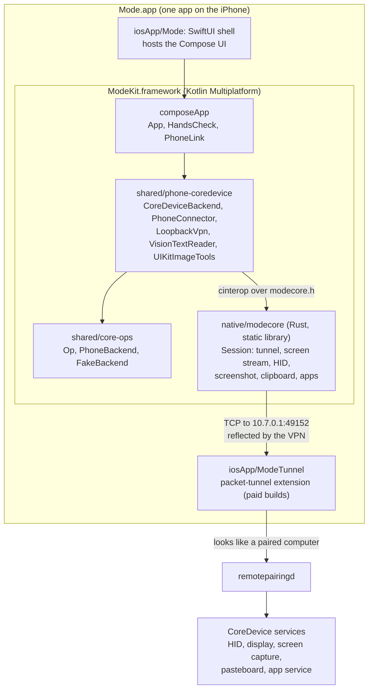
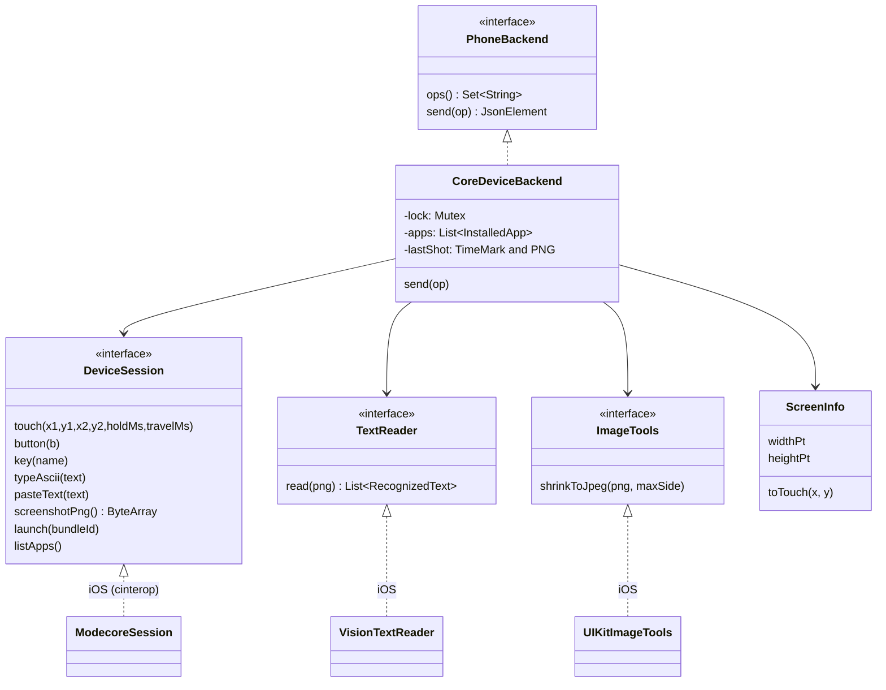
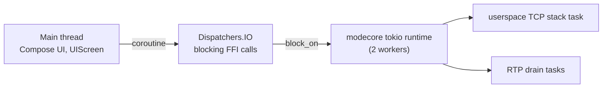
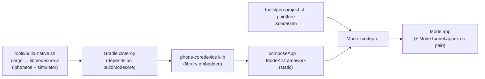

# Architecture

## The layers



On free builds there is no `ModeTunnel`; the LocalDevVPN app plays the same
role with the same addresses.

## Modules

| Module | Language | Role | Key files |
|---|---|---|---|
| `shared/core-ops` | Kotlin (common) | What can be asked of a phone, independent of platform | `Op.kt`, `PhoneBackend.kt`, `FakeBackend.kt` |
| `shared/phone-coredevice` | Kotlin (common + iOS) | The iPhone backend over CoreDevice | `CoreDeviceBackend.kt` (common), `ModecoreSession.kt`, `PhoneConnector.kt`, `LoopbackVpn.kt`, `VisionTextReader.kt` (iOS) |
| `native/modecore` | Rust | The live connection to the phone's services | `session.rs`, `ffi.rs`, `keys.rs`, `pairing.rs`, `include/modecore.h` |
| `composeApp` | Kotlin + Compose | The UI; today a hands-check screen | `App.kt`, `HandsCheck.kt`, `PhoneLink.kt`, `IosEntry.kt` |
| `iosApp/Mode` | Swift | App entry; hosts the Compose view controller | `ModeApp.swift` |
| `iosApp/ModeTunnel` | Swift | Loopback VPN (paid builds only) | `PacketTunnelProvider.swift` |
| `tools/` | Shell | Build and setup | `build-native.sh`, `make-pairing.sh`, `gen-project.sh` |

## The op model (`shared/core-ops`)

Everything the agent can ask of a phone is an `Op`: a serializable sealed
interface named for what it means, never for how a platform does it. The wire
names are phone-harness's, so the same ops could drive its cloud iPhone host.

| Op | Wire name | iOS (CoreDevice) |
|---|---|---|
| `Tap(x, y)` | `input.tap` | ✅ |
| `LongPress(x, y, duration)` | `input.press` | ✅ |
| `Drag(x1, y1, x2, y2, duration)` | `input.drag` | ✅ |
| `Scroll(x, y, dy, dx)` | `input.scroll` | ✅ (negative `dy` reveals content below) |
| `TypeText(text)` | `input.text` | ✅ (ASCII typed; anything else pasted) |
| `PressKey(combo)` | `input.keys` | ✅ named keys only |
| `Home` | `nav.home` | ✅ |
| `LaunchApp(name, fresh)` | `apps.launch` | ✅ by bundle id or name; `fresh` unsupported |
| `ScreenCapture(maxSize?)` | `screen.capture` | ✅ PNG, or a shrunk JPEG |
| `ScreenText(minConfidence)` | `screen.text` | ✅ on-device OCR, `source: "ocr"` |
| `ScreenBounds` | `screen.bounds` | ✅ |
| `SessionState` | `session.state` | ✅ |
| `Tree` | `tree` | ❌ Unsupported (no accessibility tree on this path) |
| `CurrentApp` | `apps.current` | ❌ Unsupported |
| `OpenUrl(url)` | `url.open` | ❌ Unsupported (a background app cannot open URLs) |

`PhoneBackend` is the one seam every phone sits behind:

```kotlin
interface PhoneBackend {
    val name: String
    suspend fun ops(): Set<String>          // wire names it answers
    suspend fun send(op: Op): JsonElement   // run one op
}
```

Errors are typed:

- `Unsupported`: this phone cannot do that op, and retrying will not help.
- `PhoneUnavailable`: the phone cannot be reached; the message says what to fix.
- `OpFailed`: the op ran and did not work (for example, no app by that name).

A backend never fakes what it cannot do. A guessed result the caller cannot
tell from a real one is worse than an honest `Unsupported`.

**Coordinates** are screen points with a top-left origin (402 × 874 on an
iPhone 17 Pro). The backend maps them to the touchscreen's own space,
0..65535 on each axis.

## Inside `CoreDeviceBackend`

The backend is common code, so it is tested on the JVM against a fake phone.
It depends only on small interfaces:



Rules it follows:

- **One op at a time.** A `Mutex` serialises ops, and the blocking native
  calls run on `Dispatchers.IO`.
- **One screenshot per look.** A read (`screen.capture`, `screen.text`) reuses
  the last screenshot if no action happened since and it is under 1.5 s old.
  Any action clears it.
- **Text is typed if possible, else pasted.** `Keys.typeable` is true for
  printable ASCII plus newline and tab. Anything else goes through the
  clipboard.
- **App names resolve against the installed list.** The match is exact
  (ignoring case), then the only prefix match, then the only substring match.
  An ambiguous name fails with the candidates listed. The list is cached and
  refreshed once on a miss.
- **OCR boxes become tap-ready points.** Vision returns fractions of the
  image, which are mapped to screen points with the centre given as `x, y`.

## Inside `native/modecore`

One `Session` per connection:

| Field | What |
|---|---|
| `rt` | A 2-thread tokio runtime that owns the background tasks |
| `adapter`, `handshake` | The userspace TCP stack over the tunnel, plus the RSD service directory |
| `display` | The `DisplayService` client, kept for the whole session (see below) |
| `drains` | Two tasks reading and discarding RTP audio and video, so nothing piles up in memory |
| `touch` | `UniversalHidServiceClient`, the touchscreen reports |
| `indigo` | `IndigoHidClient`, buttons and the keyboard |

**Why the screen stream exists.** iOS 27 silently drops touch and keyboard
input from a client that has no media stream open. So the session opens one
audio+video screen-sharing stream at the start and keeps it until the session
closes. Opening a stream per gesture costs about a second, and has been seen to
wedge the phone's media daemon until reboot.

The C API (`include/modecore.h`) returns `NULL` on success or an error string
the caller frees. Panics are caught at the boundary.

```c
char *mc_session_open_rppairing(host, port, hostname, pairing, len, &session);
char *mc_touch(s, x1, y1, x2, y2, hold_ms, travel_ms);
char *mc_button(s, 0=home|1=lock|2=vol+|3=vol-);
char *mc_key_named(s, "return");
char *mc_type_ascii(s, text);
char *mc_paste_text(s, text);        // clipboard + Cmd+V
char *mc_screenshot(s, &png, &len);
char *mc_launch(s, bundle_id);
char *mc_list_apps(s, &json);
void  mc_session_close(s);
```

The static library (about 31 MB) is embedded in the Kotlin klib through the
cinterop `.def` (`staticLibraries`), so it ends up inside `ModeKit.framework`.

## Threading



## Build



| Build | Spec | Includes |
|---|---|---|
| Paid | `iosApp/project.paid.yml` (includes `project.yml`) | `ModeTunnel` extension, Network Extension entitlement, `ModeBuiltInVPN = true` |
| Free | `iosApp/project.yml` | No extension; relies on the LocalDevVPN app |

## Versions

Kotlin 2.4.10, Compose Multiplatform 1.11.1, kotlinx-coroutines 1.11.0,
kotlinx-serialization 1.11.0, Rust 1.99, idevice pinned at `8970209`,
Xcode 27.1, deployment target iOS 26.0. CoreDevice remote control itself
needs iOS 27.
