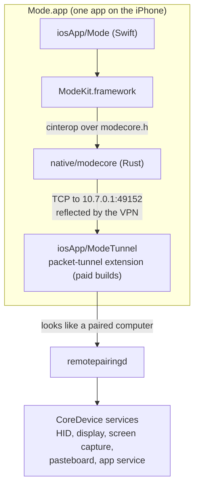
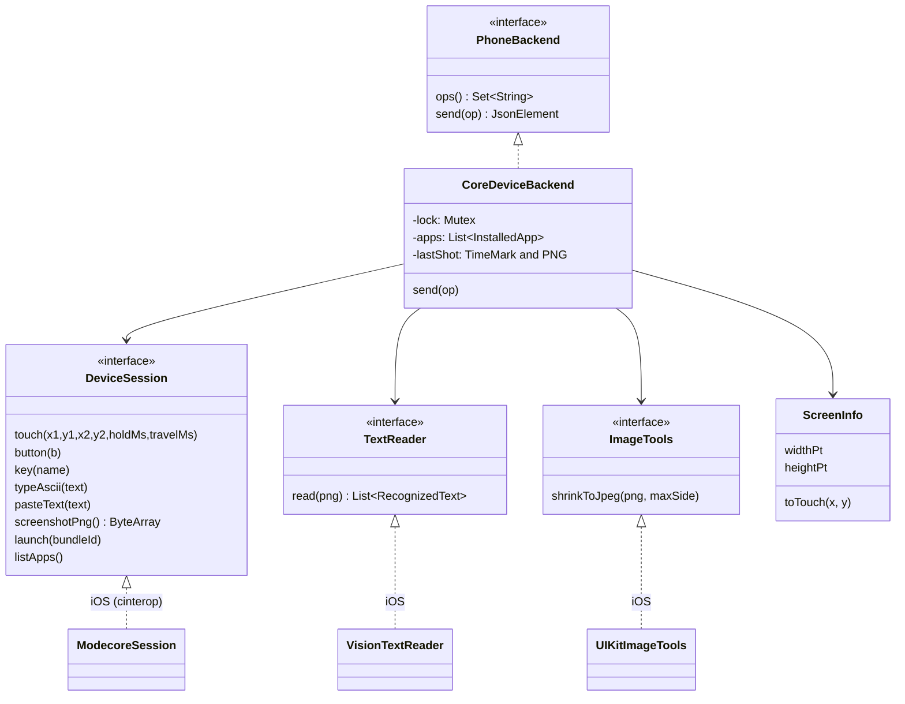
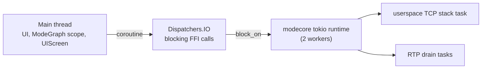
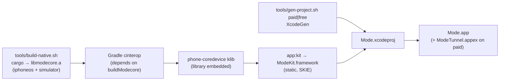

# Architecture

## Modules and layers

Mode is split into small Gradle modules in four layers. A module may use
modules in its own layer or below, never above:

```mermaid
flowchart TB
    subgraph app["app: what ships"]
        kit["app:kit<br/>ModeKit.framework (+ SKIE)"]
        devui["app:dev-ui<br/>Compose developer screens"]
        graph["app:graph<br/>ModeGraph: builds and wires everything"]
        androidapp["app:android<br/>the Android app (Compose)"]
    end
    subgraph feature["feature: one module per feature"]
        tasks["tasks<br/>TaskRunner, questions"]
        compare["compare<br/>model bake-off"]
        diag["diagnostics<br/>HandsCheck"]
        conn["connection<br/>PhoneSession, PhoneLink"]
        settings["settings<br/>key, models"]
        runs["runs<br/>RunRecorder, history"]
    end
    subgraph engine["engine: the product's core logic"]
        agent["agent<br/>look → decide → act"]
        llm["llm<br/>LlmClient, OpenRouter"]
        ops["ops<br/>Op, PhoneBackend"]
        screen["screen<br/>the screen in points, text boxes, ScreenJson"]
        ios["phone-ios<br/>CoreDevice backend, VPN, pairing"]
    end
    subgraph core["core: plumbing, no product logic"]
        common["common<br/>AppLog, ActivityTracker"]
        storage["storage<br/>secrets, settings, files"]
        platform["platform<br/>lifecycle, background, notifications"]
        network["network<br/>HTTP client"]
    end
    kit --> devui --> graph
    androidapp --> graph
    graph --> tasks & compare & diag
    compare --> tasks
    tasks --> conn & settings & runs
    diag --> conn
    tasks & runs & settings --> agent
    agent --> llm & ops
    conn --> ops
    conn -. iOS .-> ios
    ios --> screen --> ops
    ios -- "cinterop" --> native["native/modecore (Rust)"]
    feature --> core
```

`./gradlew checkModuleRules` (also part of `check`) fails the build when a
module depends on a layer above it. `:testing` (fakes shared by tests) sits
outside the layers and is used only by test source sets.

Every shared module builds for the iPhone, for Android and for the JVM (the
JVM only runs the tests). The convention plugin adds the targets; a module
opts out in its `gradle.properties` (`mode.android=false` for the iPhone
engine, `mode.ios=false` for an Android-only engine). Platform code lives in
`iosMain` and `androidMain` behind interfaces declared in `commonMain`; there
are no `expect` declarations except the time-of-day helper and the test
database.

| Layer | Module | Role |
|---|---|---|
| core | `core:common` | `AppLog` (event timeline), time ids, `ActivityTracker` (is anything using the phone?), `SecretFilter`, `systemLog` on iOS |
| core | `core:storage` | `SecretStore`, `KeyValueStore`, `FileStore`; iOS: Keychain, UserDefaults, Documents; Android: the Keystore (`KeystoreSecretStore`, AES-GCM, `SealedValue`), SharedPreferences, the app's files |
| core | `core:platform` | `AppInfo`, `AppLifecycle`, `BackgroundWork`, `Notifier`, `Permissions`, `DeviceLock`; iOS: KeepAwake, background task, notifications; Android: the process lifecycle, the keyguard, permission prompts through `ActivityBridge` |
| core | `core:network` | The HTTP client (Darwin on iOS, OkHttp on Android) |
| core | `core:database` | The on-device SQLite database (SQLDelight, schema v3, upgrades checked): conversations, turns, tasks, the run index, memory, schedules; `mode.db` on both phones |
| engine | `engine:ops` | What can be asked of a phone: `Op`, `PhoneBackend`, `ResilientBackend`, `FakeBackend` |
| engine | `engine:screen` | What every phone engine shares: `ScreenInfo` (points), `TextReader` and `RecognizedText`, `ImageTools`, `AppNames`, `ScreenJson` (the answers' shapes), `ShotCache` |
| engine | `engine:llm` | `LlmClient`, `OpenRouterClient`, and `OpenRouterModels` (the live model catalogue) |
| engine | `engine:agent` | The agent loop, its tools, `ContextBuilder` (what the model sees), `StuckDetector`, `AgentTrace` and `PhoneProfile` (what differs per phone) |
| engine | `engine:phone-ios` | The iPhone backend over CoreDevice, the VPN and the pairing file |
| feature | `feature:connection` | `PhoneSession` (one shared session, `ConnectionState`), the `PhoneLink` port, `IdleDisconnectPolicy` |
| feature | `feature:settings` | `SettingsRepository` (typed `ModeSettings`, including the per-task cost limit) and `ModelCatalog` (usable models with cost per task, cached a day) |
| feature | `feature:runs` | `RunRecorder`, `RunRepository` (listed from the database; events and screenshots stay files) |
| feature | `feature:conversations` | `ConversationRepository`: conversations and their turns |
| feature | `feature:memory` | `MemoryRepository` (facts, skills, app tips; merge, undo), `MemoryRetrieval` (what a task gets, `recall`), `Reflector` (learns after each task) |
| feature | `feature:tasks` | `TaskRunner` (one task at a time under a phone lock), `TaskQueue` / `TaskInbox` (the one way in for every source), `TaskMemory`, `TaskRepository` |
| feature | `feature:schedules` | `ScheduleRule` (next run, local time), `ScheduleRepository`, `Scheduler` (due tasks to the inbox, notifications) |
| feature | `feature:diagnostics` | `HandsCheck` |
| feature | `feature:backup` | `BackupService`: one `.modebackup` file with every table and the settings (and, locked with a password, the sign-ins); restore merges, never deletes (D40) |
| feature | `feature:compare` | `CompareRunner` |
| app | `app:screens` | One presenter per screen (`StateFlow<UiState>` plus intents): Home, Conversation, Live run, Run screens, Tasks, Repeat, Memory, Settings, Onboarding; `Screens` makes them. Shared with a future Android UI |
| app | `app:graph` | `ModeGraph`, the one composition root; `iosModeGraph` and `androidModeGraph` wire each platform's implementations |
| app | `app:android` | The Android app: Compose screens over the shared presenters, and the services and receivers Android needs in the app itself (`full` and `play` flavours) |
| app | `app:dev-ui` | The Compose developer screens (Agent, Compare, Logs, Settings, Hands), reachable from Settings › Developer |
| app | `app:kit` | Builds `ModeKit.framework` for Swift (SKIE on, analytics off); `IosEntryKt.MainViewController()` |
| — | `native/modecore` | Rust: the live connection to the phone's services |
| — | `iosApp/Packages/ModeDesignSystem` | Swift package: every colour, font, size, radius, icon and component (Liquid Glass) |
| — | `iosApp/Mode` | The SwiftUI app: `App/` (tabs, routes), `Features/<Screen>/` (a pure view plus its ViewModel), `Presentation/` (formatting, flow observing), `Resources/` (L10n, string catalog) |
| — | `iosApp/ModeTunnel` | The loopback VPN extension (paid builds) |

### Inside a feature module

```
feature/<name>/src/commonMain/kotlin/com/piyush/mode/feature/<name>/
  domain/        models and interfaces (ports) other modules may use
  data/          implementations (repositories, platform adapters)
  presentation/  state holders: a StateFlow of state plus intent functions; no UI
src/iosMain/…    iOS implementations of the module's ports
src/commonTest/… tests on the JVM with the fakes from :testing
```

- **Explicit API**: only what other modules need is `public`; everything
  else is `internal` (the `mode.kmp.feature` convention turns this on).
- **State** is a `StateFlow` of an immutable state class. Compose collects it
  with `collectAsState`; SwiftUI observes it through SKIE. No Compose state
  outside UI modules.
- **Dependencies come in through constructors.** Only `ModeGraph` constructs
  features. There is no DI library.
- **Features don't reach into each other's internals.** Cross-cutting needs go
  through core (for example, `ActivityTracker` lets the connection feature
  know whether a task, a check or a comparison is running).

### Adding a feature

1. Create `feature/<name>/build.gradle.kts` with `id("mode.kmp.feature")` and
   only the dependencies it needs; add `include(":feature:<name>")` to
   `settings.gradle.kts`.
2. Put models and ports in `domain/`, implementations in `data/`, and a state
   holder in `presentation/`.
3. Write tests in `commonTest` with `:testing` fakes; run `./gradlew jvmTest`.
4. Construct it in `ModeGraph` and, if Swift needs it, `export` it in
   `app/kit/build.gradle.kts`.
5. `./gradlew check` must pass, including `checkModuleRules`.

## The runtime path



On free builds there is no `ModeTunnel`; the LocalDevVPN app plays the same
role with the same addresses.

## The op model (`engine:ops`)

Everything the agent can ask of a phone is an `Op`: a serializable sealed
interface named for what it means, never for how a platform does it. The wire
names are phone-harness's, so the same ops could drive its cloud iPhone host.

| Op | Wire name | iOS (CoreDevice) |
|---|---|---|
| `Tap(x, y)` | `input.tap` | ✅ |
| `LongPress(x, y, duration)` | `input.press` | ✅ |
| `Drag(x1, y1, x2, y2, duration)` | `input.drag` | ✅ |
| `Scroll(x, y, dy, dx)` | `input.scroll` | ✅ (negative `dy` reveals content below) |
| `TypeText(text)` | `input.text` | ✅ (ASCII typed; anything else pasted) |
| `PressKey(combo)` | `input.keys` | ✅ named keys only |
| `Home` | `nav.home` | ✅ |
| `LaunchApp(name, fresh)` | `apps.launch` | ✅ by bundle id or name; `fresh` unsupported |
| `ScreenCapture(maxSize?)` | `screen.capture` | ✅ PNG, or a shrunk JPEG |
| `ScreenText(minConfidence)` | `screen.text` | ✅ on-device OCR, `source: "ocr"` |
| `ScreenBounds` | `screen.bounds` | ✅ |
| `SessionState` | `session.state` | ✅ |
| `Tree` | `tree` | ❌ Unsupported (no accessibility tree on this path) |
| `CurrentApp` | `apps.current` | ❌ Unsupported |
| `OpenUrl(url)` | `url.open` | ❌ Unsupported (a background app cannot open URLs) |
| `Back` | `nav.back` | ❌ Unsupported (iOS has no Back; the agent swipes from the edge) |
| `Recents` | `nav.recents` | ❌ Unsupported |
| `OpenNotifications` | `notifications.open` | ❌ Unsupported |
| `OpenQuickSettings` | `quicksettings.open` | ❌ Unsupported (iOS has Control Center, opened by a drag) |

The last four are Android's: its accessibility service does them as global
actions. A text box may carry `window` (`"app"`, `"ime"` for the keyboard,
`"system"`) when the phone knows which window it is in; a capture may answer
`{"private": true, bounds}` for a screen the phone will not show (a bank, a
PIN pad), which the agent treats as the user's turn.

`PhoneBackend` is the one seam every phone sits behind:

```kotlin
interface PhoneBackend {
    val name: String
    suspend fun ops(): Set<String>          // wire names it answers
    suspend fun send(op: Op): JsonElement   // run one op
}
```

Errors are typed:

- `Unsupported`: this phone cannot do that op, and retrying will not help.
- `PhoneUnavailable`: the phone cannot be reached; the message says what to fix.
- `OpFailed`: the op ran and did not work (for example, no app by that name).

A backend never fakes what it cannot do. A guessed result the caller cannot
tell from a real one is worse than an honest `Unsupported`.

**Coordinates** are screen points with a top-left origin (402 × 874 on an
iPhone 17 Pro; on Android, dp). The iPhone backend maps them to the
touchscreen's own space, 0..65535 on each axis.

## Two phones, one agent: `PhoneProfile`

The agent is the same on both phones. What differs is a `PhoneProfile`
(`engine:agent`), passed in by the platform through `PlatformServices` and
down to `TaskRunner`: the words in the prompts ("iPhone", "Android phone"),
how far down the status bar reaches, whether going back is an op (`nav.back`)
or an edge swipe, which quick panel exists (Control Center, Quick Settings)
and whether the user's Shortcuts can be run. The tools offered follow the
profile and the ops the phone answers: on Android `back`, `quick_settings`
and `notifications`; on the iPhone `back` (a drag), `control_center` and
`run_shortcut`. The iPhone profile is the default, and a test keeps its
prompt and tool list as they were.

## Inside `CoreDeviceBackend`

The backend is common code, so it is tested on the JVM against a fake phone.
It depends only on small interfaces:



Rules it follows:

- **One op at a time.** A `Mutex` serialises ops, and the blocking native
  calls run on `Dispatchers.IO`.
- **One screenshot per look.** A read (`screen.capture`, `screen.text`) reuses
  the last screenshot if no action happened since and it is under 1.5 s old.
  Any action clears it.
- **Text is typed if possible, else pasted.** `Keys.typeable` is true for
  printable ASCII plus newline and tab. Anything else goes through the
  clipboard.
- **App names resolve against the installed list.** The match is exact
  (ignoring case), then the only prefix match, then the only substring match.
  An ambiguous name fails with the candidates listed. The list is cached and
  refreshed once on a miss.
- **OCR boxes become tap-ready points.** Vision returns fractions of the
  image, which are mapped to screen points with the centre given as `x, y`.

## Inside `native/modecore`

One `Session` per connection:

| Field | What |
|---|---|
| `rt` | A 2-thread tokio runtime that owns the background tasks |
| `adapter`, `handshake` | The userspace TCP stack over the tunnel, plus the RSD service directory |
| `display` | The `DisplayService` client, kept for the whole session (see below) |
| `drains` | Two tasks reading and discarding RTP audio and video, so nothing piles up in memory |
| `touch` | `UniversalHidServiceClient`, the touchscreen reports |
| `indigo` | `IndigoHidClient`, buttons and the keyboard |

**Why the screen stream exists.** iOS 27 silently drops touch and keyboard
input from a client that has no media stream open. So the session opens one
audio+video screen-sharing stream at the start and keeps it until the session
closes. Opening a stream per gesture costs about a second, and has been seen to
wedge the phone's media daemon until reboot.

The C API (`include/modecore.h`) returns `NULL` on success or an error string
the caller frees. Panics are caught at the boundary.

```c
char *mc_session_open_rppairing(host, port, hostname, pairing, len, &session);
char *mc_touch(s, x1, y1, x2, y2, hold_ms, travel_ms);
char *mc_button(s, 0=home|1=lock|2=vol+|3=vol-);
char *mc_key_named(s, "return");
char *mc_type_ascii(s, text);
char *mc_paste_text(s, text);        // clipboard + Cmd+V
char *mc_screenshot(s, &png, &len);
char *mc_launch(s, bundle_id);
char *mc_list_apps(s, &json);
void  mc_session_close(s);
```

The static library (about 31 MB) is embedded in the Kotlin klib through the
cinterop `.def` (`staticLibraries`), so it ends up inside `ModeKit.framework`.

## Threading



## Build



| Build | Spec | Includes |
|---|---|---|
| Paid | `iosApp/project.paid.yml` (includes `project.yml`) | `ModeTunnel` extension, Network Extension entitlement, `ModeBuiltInVPN = true` |
| Free | `iosApp/project.yml` | No extension; relies on the LocalDevVPN app |

## Versions

Kotlin 2.4.10, Gradle 9.6.1, SKIE 0.10.15, Compose Multiplatform 1.11.1, kotlinx-coroutines 1.11.0,
kotlinx-serialization 1.11.0, Rust 1.99, idevice pinned at `8970209`,
Xcode 27.1, deployment target iOS 26.0. CoreDevice remote control itself
needs iOS 27.

## The iOS UI: design system, dumb views, shared presenters

```
SwiftUI view (state in, events out; no logic)
   ↑ display state          ↓ events
Swift ViewModel (@Observable: observe the presenter, map to display state, forward events, navigate)
   ↑ StateFlow<UiState>     ↓ intents
Kotlin presenter (app:screens: every decision)
   ↓
feature modules
```

- **Design system (`ModeDesignSystem`):**
  - **Tokens:** `ModeColor` (light and dark, from the design canvas), `ModeTextStyle`
    (Instrument Sans headings, SF body, Dynamic Type), `ModeSpacing`, `ModeSize`,
    `ModeRadius`, `ModeMotion`, `ModeIcon`.
  - **Components:** buttons, cards, rows, chips, badges, fields, the message bar,
    step rows, empty states, the running bar.
  - Screens use these and nothing else.
- **No literals in screens.** `tools/check-ui-literals.sh` runs on every Xcode
  build. It fails the build when anything under `Mode/Features` or `Mode/App`
  hard-codes a colour, font, number size, radius, SF Symbol name or visible
  string. Strings live in `Resources/L10n.swift`, and the compiler fills
  `Localizable.xcstrings`.
- **Dumb views.** A screen is `XScreen(state:onEvent:)`. `XViewModel` owns the
  presenter, maps its semantic state into words (with `Format`), and handles
  events. `XRoute` connects the two. Decisions about data belong in the Kotlin
  presenter, so an Android UI gets them for free.

