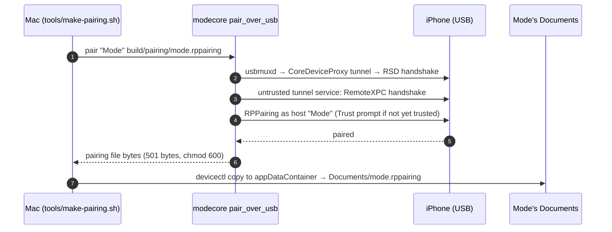
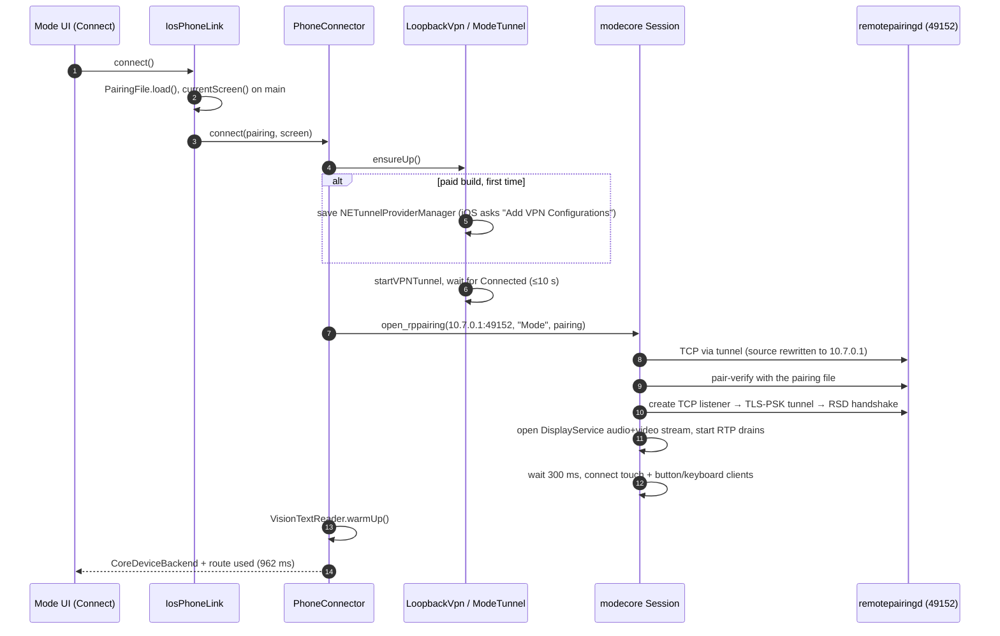
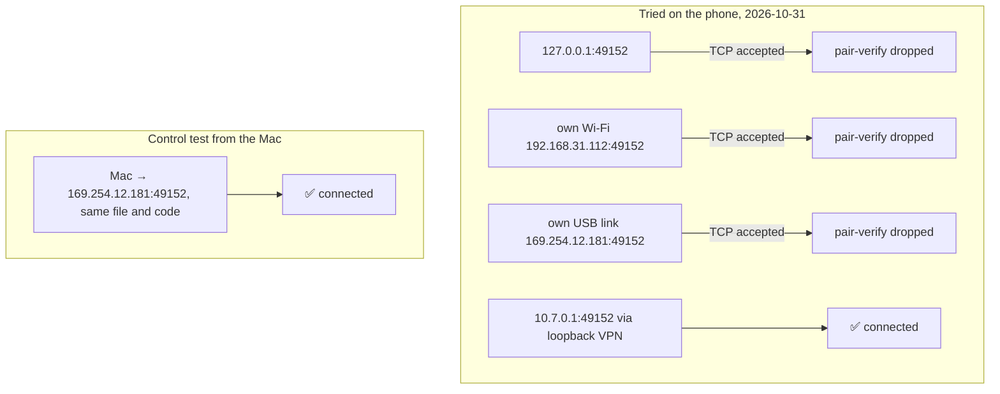
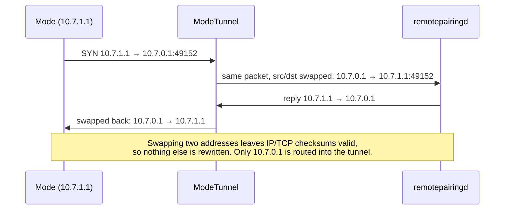
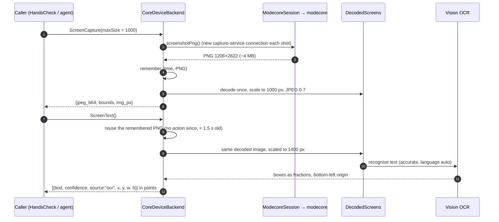
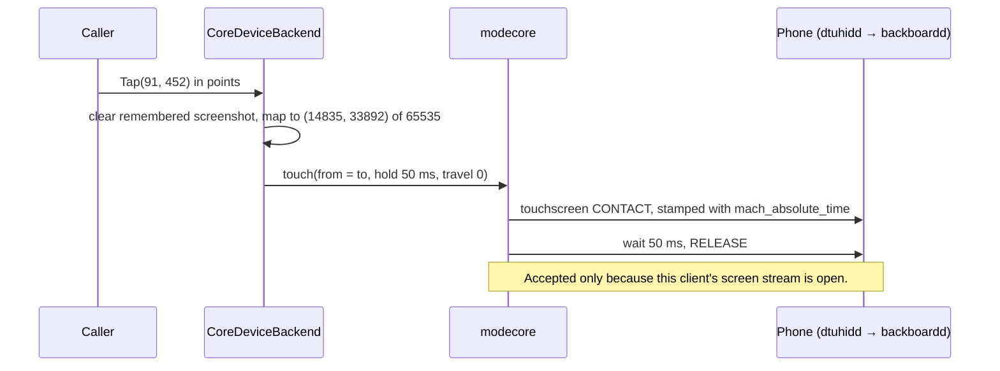
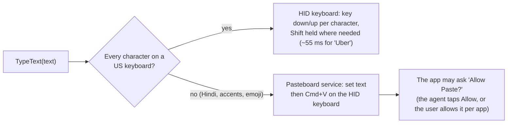
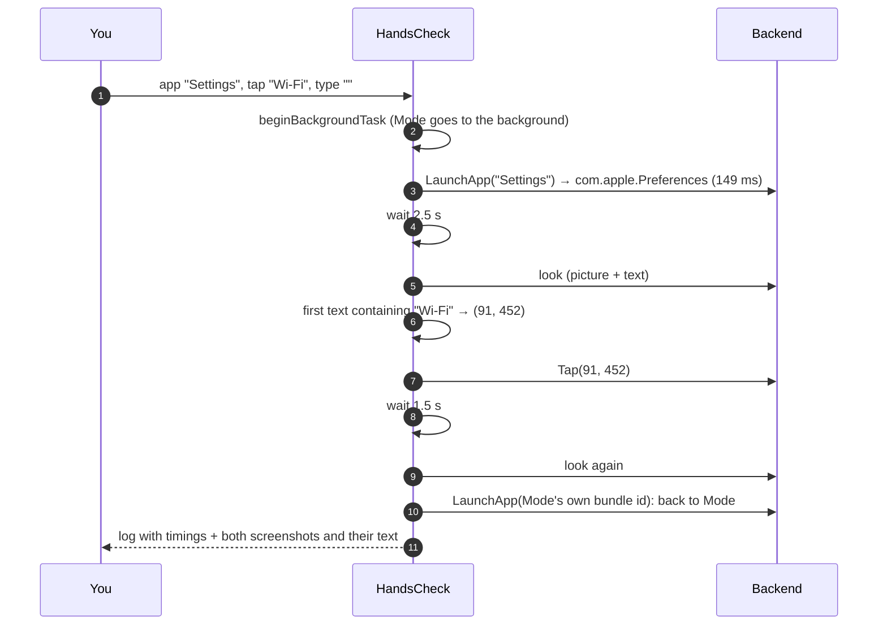
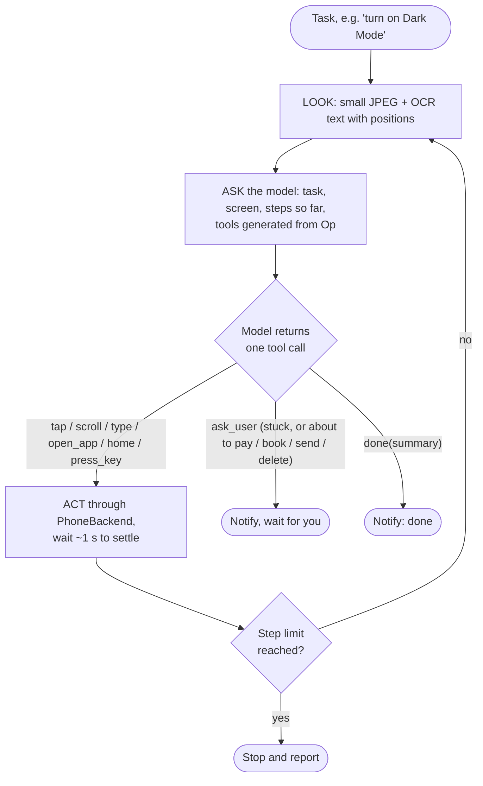

# Flows

## 1. One-time pairing (Mac, USB)

The phone only talks to computers it trusts. `tools/make-pairing.sh` makes
Mode one of them, once.

Redo it only if the phone stops trusting the Mac: Developer Mode turned off and
on, or Location & Privacy reset. Free accounts without Mac tools can drop the
file into Mode's folder through Finder or the Files app instead.

## 2. Connecting from the phone

## 3. Why the VPN: how the phone sees each route

The phone refuses pairing on any connection that starts on the phone itself,
whichever address it targets. The VPN sends every packet for `10.7.0.1`
straight back with its source and destination swapped. The pairing service
therefore sees a connection from `10.7.0.1`, a peer, and accepts it.

## 4. A look (screen.capture + screen.text)

Measured on the phone: **1413 ms** for the first look (picture 694 ms + text
719 ms) and **825 ms** for the next (417 + 408). Before the speed fix, a look
took about 7–8 s (two screenshots, two decodes, full-size OCR).

## 5. A tap

A scroll is the same touch with travel: the finger goes down, moves in
16 ms frames at about 800 pt/s, rests 100 ms so the list stops where the
finger stops, then lifts.

## 6. Typing

## 7. The hands check (today's test screen)

It proves the hands work from the phone. Everything it does comes from what
the user types in; there is no task logic in it.

## 8. The agent loop (planned, Phase 6)

Example: "open General in Settings". Nobody codes where General is.

| Step | Model sees | Model does |
|---|---|---|
| 1 | Home Screen | `open_app("Settings")` |
| 2 | Settings, top: Wi-Fi, Bluetooth… no General | `scroll(201, 600, dy=-400)` |
| 3 | General at (110, 520) | `tap(110, 520)` |
| 4 | General screen | `done("Opened General")` |

Expected pace: 3–5 s per step (look ~1 s, model 1–3 s, act + settle ~1 s).
