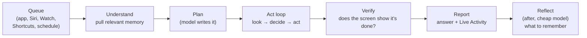

# The harness: how Mode thinks, remembers and stays within budget

Status: **agreed** (2026-11-01), to build before the SwiftUI app, since every
screen shows what the harness produces. Decided: memory saves by itself with a
"Remembered · Undo" chip; the cost limit is $0.05 per task by default,
changeable in Settings.

The harness is everything around the model: what it is shown each step, what
it can do, what Mode remembers between tasks, which settings shape it, and how
tasks are queued, checked and recorded. The rule stays the same as today:
**nothing is hard-coded per app or task.** The model decides every step; the
harness gives it eyes, hands, memory and limits.

## 1. Where we are

- Each step is one stateless call: the system prompt, the task, the plan,
  the user's answers, one line per recent step (the last 12), and the current
  screen (a ~1000 px JPEG plus OCR text with positions). The history never
  grows into a chat transcript, and old screenshots are never resent.
- Tools: tap, long_press, swipe, scroll, type_text, press_key, back,
  control_center, home, open_app, plan, wait, ask_user, done.
- Escalation to a stronger model after two steps without progress; retries
  and a fallback when a model call fails.
- Each run is recorded (`runs/<id>`) with every prompt, answer and screenshot.

What is missing: no memory between tasks, no follow-ups in a conversation, no
queue (one task at a time, from the app only), no place to keep facts found
mid-task, no cost limit, no caching, and settings are a few free-text fields.

## 2. The model of things

```
Conversation ── Turn (you) ── Task ── Run ── Step
                 Turn (Mode)                  └ screenshot, action, result
Memory: Person · Preference · AppNote · (runs are the episodes)
TaskQueue ← sources: app, Siri, Watch, Shortcuts, schedule
```

- **Conversation:** a thread of turns. A follow-up ("also tell Rahul") is a new
  task in the same conversation, and the model sees the earlier turns' outcomes.
- **Task:** what to do, where it came from, and its status: queued, running,
  waiting for you, done, could not finish, stopped. It has its plan, notes,
  result and cost.
- **Run:** one attempt at a task (a retry is a new run). It is what
  `RunRecorder` writes today.
- **Memory items:** described in section 4.

All of this lives in one on-device SQLite database. Screenshots stay as
files, with an index row per run.

## 3. One task, start to finish



1. **Queue.** One phone means one task at a time. Tasks from any source go into
   one queue, in order. Scheduled tasks ("every day at 8") are added by a timer.
2. **Understand.** Before the first step, the harness finds the memory items
   this task needs: the people, apps and preferences it mentions. They go into
   the prompt (section 5). No model call is needed for this.
3. **Plan.** The model writes a short plan for any task with several parts,
   as it does today.
4. **Act loop.** As now, with two new tools:
   - `note`: keep a fact found on the way ("14:00 Biozyme with lunch").
     Notes stay in the prompt for the rest of the task, even after the step
     history is trimmed, and feed the final answer. Built as an optional
     field on every action rather than its own tool, so keeping a fact never
     costs a step (D28).
   - `recall(query)`: look up memory mid-task ("Asha's number"),
     for things the first pull didn't foresee.
5. **Verify.** Before `done` is accepted, the model must say what on the
   current screen shows the task is complete. If it can't, the harness gives
   it one more step to check. This catches "I tapped Send" when nothing was
   sent.
6. **Report.** The answer goes to the conversation, the notification and the
   Live Activity.
7. **Reflect.** After the task, one call to the cheap model reads the run's
   summary and proposes memory changes (section 4). It runs after you have
   your answer, so it never slows a task down.

**Stop conditions:** max steps; **max cost per task**; stuck (the same screen 4
times despite different actions, even after stepping up); max time; or the
user's Stop. Each ends with an honest summary of how far it got.

## 4. Memory

Three kinds, each with a different job:

| Kind | What it holds | Example | Written by |
|---|---|---|---|
| **About you** | People, preferences, places, accounts in use | "Asha: message on WhatsApp"; "messages short and casual"; "Home: [address]" | Reflection after tasks; you, in the Memory screen |
| **How to do it** | Notes per app on what worked or failed (procedural memory, the biggest win in the research) | "Settings: search 'Dark Mode' goes straight there"; "Calendar: tap Today, then scroll; events may be below the fold" | Reflection, from successful runs and from failures |
| **What happened** | The runs themselves: task, outcome, summary | "Sent Asha 'Leaving in 10' (1 Nov)" | Already recorded; indexed for search |

**Writing (reflection):** after each task, the cheap model gets the task, the
plan, the step lines (no screenshots) and the current memory items for those
people and apps, and returns a small list of changes: add, update or forget,
each with **evidence** (the step or answer it came from). The harness then:

- **Never stores secrets.** Anything that looks like a password, passcode,
  one-time code, card number or ID number is dropped by a filter before
  saving, whatever the model says.
- Merges duplicates, and marks an item "confirmed" when a later run uses it
  successfully.
- Shows each new "about you" item once in the conversation ("Remembered:
  Asha is on WhatsApp · Undo"), as designed. App notes save quietly.
- Lets an item expire when it stops helping. An app note that preceded a
  failure loses confidence; one the app's update made wrong is replaced.

**Reading:** at the Understand step, items are matched by the people, apps and
words in the task (plain keyword and tag matching, which is fast and enough
for a few hundred items). Later, Apple's on-device sentence embeddings
(NaturalLanguage) can add meaning-based matching, still with nothing leaving
the phone. A budget caps what goes in: about 25 "about you" lines and 10 app
notes, ranked by match, confirmations and recency.

**Your control:** the Memory screen lists everything, and you can edit, delete
or "forget everything". There's also a switch for learning from tasks. Memory
never leaves the phone except the lines included in a task's prompt.

## 5. Context: what the model sees each step

The prompt is built in fixed sections, stable parts first, so providers that
cache prompts (Anthropic through OpenRouter) can reuse them from step to step:

| # | Section | Changes | Budget |
|---|---|---|---|
| 1 | Rules and iOS know-how (system prompt) | Never | ~1.8K tokens |
| 2 | Tools | Never | ~0.8K |
| 3 | About you: matched memory, plus your name | Per task | ≤ 25 lines |
| 4 | App notes for apps in this task | Per task (or on `recall`) | ≤ 10 notes |
| 5 | The conversation so far: earlier turns' outcomes | Per task | ≤ 3 turns |
| 6 | The task, your answers, the plan | Rarely | — |
| 7 | Notes kept in this task | Grows | ≤ 30 lines |
| 8 | Steps: the last 12 verbatim, with a one-line summary of earlier steps | Each step | ~15 lines |
| 9 | The screen: screenshot + OCR text with positions | Each step | 1 image + ≤ 80 texts |

- **A cache point after section 6** (or after 4 when the plan is changing): on
  long tasks most of the prompt's text is then cached. The screenshot is
  always new and can't be cached.
- **Hard rules are restated every step** in section 1, never summarised away.
  Recent work shows trimming context can drop constraints, so rules are never
  trimmed.
- **Nothing grows without a cap.** Every section has a budget; when one is
  full, its oldest or least relevant entries go first.
- **Images:** sized per model (smaller for cheaper models), and an extra
  "before" thumbnail only when the last action seemed to do nothing.

## 6. Settings (the logic behind the Settings screen)

| Setting | Default | Notes |
|---|---|---|
| OpenRouter key | — | Keychain; set by Connect OpenRouter or pasting |
| Main model | Claude Haiku 5.5 | Picked from a list built from OpenRouter's live catalogue, filtered to models with image input and tool calls, with an approximate cost per task |
| Model when stuck | Claude Sonnet 5.5 | Or none |
| Model for reflection and summaries | Same as main | Small, cheap calls |
| Max steps per task | 30 | |
| **Max cost per task** | $0.05 | Changeable in Settings; stops with a summary; protects against loops |
| Daily spend cap | Off | Optional |
| Learn from tasks | On | Memory writing; reading still works when off |
| Ask before sending, paying or deleting | Only very risky actions | Your preference: as few questions as possible |
| Your name | From your contact card | |

Settings are typed and stored in one place (`feature:settings`), and each
change is read at the next task, never mid-task.

## 7. Modules (fits the step-1 architecture)

| Module | New or changed | Holds |
|---|---|---|
| `core:database` | New | SQLite (SQLDelight, shared by iOS and Android), migrations |
| `engine:agent` | Changed | `ContextBuilder` (the sections and budgets above), `note` / `recall` tools, the verify step, stop conditions |
| `engine:llm` | Changed | Cache hints, model capabilities and prices from OpenRouter's catalogue |
| `feature:memory` | New | Memory store, retrieval, the reflection writer, the secret filter |
| `feature:conversations` | New | Conversations and turns |
| `feature:tasks` | Changed | The persistent task queue, task sources, schedules, budgets; `TaskRunner` drives the phases |
| `feature:settings` | Changed | Typed settings above; model catalogue |
| `feature:runs` | Changed | Indexed in the database; screenshots stay files |

## 8. How we'll know it's better

A small scenario suite, written by us and run on the phone through the Compare
tool. Examples: dark mode, a WhatsApp message plus the calendar, a follow-up,
and a task that needs memory. Each change is measured on success, steps, time
and cost, including memory on vs off. This tells us whether app notes really
make Mode faster and cheaper, as the papers suggest.

## 9. Order of work

Progress: **step 1 (the data layer) is done** (2026-11-01): `core:database`, saved
tasks and conversations, the run index with a one-time import of earlier runs,
typed settings with the $0.05 cost limit enforced, and the live model catalogue.

**Step 2 (the context builder) is done** (2026-11-01):
- `ContextBuilder`: the sections and budgets of §5, with cache points after
  the system prompt and after the stable part. Steps older than the last 12
  become one summary line, made without a model call.
- Prompt caching through OpenRouter: `cache_control` markers for Anthropic and
  Gemini models, the same stable-first layout for the rest. Cached tokens are
  logged per step.
- Notes, as a field on every action.
- Verify: `done` needs evidence from the screen. A successful `done` with none,
  or right after an action that changed nothing, is sent back once.
- `StuckDetector`:
  - steps up after 2 unchanged screens;
  - stops after 4 unchanged once the stronger model has had a try, or after
    seeing the same screen 6 times in 12.
- A 15-minute time limit and the daily spend cap.
- `TaskContext` carries the user's name and, for a follow-up, the earlier
  turns. H3 fills in "about you" and the app notes.

**Steps 3 and 4 (memory, queue and sources) are done** (2026-11-01), after a
second round of research (table below).

**Memory (`feature:memory`, schema v2):**
- **Facts about you:** all of them, up to 25, as ChatGPT does with saved
  memories.
- **Skills:** routes that worked, with placeholders such as "Message [Person] on
  WhatsApp". They are matched on keywords, title and app. The best one, at a
  score of 0.5 or more, is given in full; others are given by name.
- **App tips:** given for the apps a task names, for apps a matched fact points
  to, and when an app opens.
- **Recent tasks:** one line each.
- **`recall`:** a tool for looking things up mid-task.
- **Ranking:** by retention, exp(−days/successes).
- **Reflector:** an outside critic that runs after each task. It sees the steps
  and the final screen, not the agent's reasons, and returns add / update /
  forget changes. The harness enforces evidence, no new skills from failures,
  failures only adding to skills, at most 5 changes, `SecretFilter`, and
  merging.
- **Undo, privacy, learning:** "Remembered · Undo" for new facts. Private tasks
  neither use nor add to memory. A Learn switch.

**Agent changes from the research:**
- The plan is recited last, so it never breaks the cache.
- An optional `expect` field on every action is checked on the next screen.

**Queue (`TaskInbox`, `TaskQueue`):**
- One way in for the app, Siri, Shortcuts, the Watch and schedules.
- Tasks run in order, under one phone lock.
- Waiting tasks can be cancelled.
- Recovery at launch: interrupted tasks are failed; queued tasks over an hour
  old are dropped.

**Schedules (`feature:schedules`, schema v3):**
- A time of day on chosen days, or once. Handles the clocks changing.
- Checked at launch, when Mode comes to the front, and every 30 s.
- A run missed by over 2 h is skipped.
- A notification at each next run opens Mode, because iOS can't start it in
  the background.

### What the research changed (2026-11-01)

| Finding | Source | What Mode does |
|---|---|---|
| Skills per intent; metadata retrieval beats full text (12/12 vs 1/12) | EvoSkill-GUI | Skills with keywords and an app, a threshold, only from successes |
| Placeholder workflows; retention ranking; keep variants | MAGNET | Placeholders, exp(−gap/uses), a different route is kept beside |
| An isolated critic reflects better (−8.5 points without it) | EvoSkill-GUI | The Reflector sees steps and the final screen, not the agent's reasons |
| All saved facts in every prompt, plus recent chat summaries | ChatGPT memory | Every fact up to 25; recent tasks section |
| Editable memory by category; incognito | Claude memory | Memory screen; private tasks |
| Let the model choose what to keep; stable prefix; progressive disclosure | Anthropic harness guide | Reflector writes; the best skill in full, others by name |
| Recite the plan at the end; keep the prefix stable | Manus | The plan moved to the end of each step |
| Pre/post-condition checks per step (+15–17 points) | Q-Reflector | `expect`, checked on the next screen, with no extra call |
| ADD / UPDATE / DELETE / NOOP over existing items | Mem0 | Reflector ops on items it is shown by id |


1. **Data layer:** `core:database`; persistent tasks, conversations and runs;
   typed settings and the model catalogue.
2. **Context builder:** the sections and budgets, `note`, the progress
   summary, the verify step, cost and stuck limits, prompt caching.
3. **Memory:** store, keyword retrieval, reflection writer, secret filter, the
   "Remembered · Undo" event, `recall`.
4. **Queue and sources:** the persistent queue, schedules, and the
   hooks Siri and the Watch will call.
5. **App know-how** quality: confidence, expiry, measured by the suite.
6. Later: on-device embeddings for meaning-based recall.

Each step is tested on the JVM with fakes, and run on the phone before the next.

## Sources

Second round (2026-11-01):
- Anthropic, harness patterns: https://claude.com/resources/articles/harnessing-claudes-intelligence
- Anthropic memory tool: https://platform.claude.com/docs/en/agents-and-tools/tool-use/memory-tool
- ChatGPT memory, reverse engineered: https://llmrefs.com/blog/reverse-engineering-chatgpt-memory
- Manus context engineering (summary): https://tianpan.co/blog/2026-03-02-context-engineering-lessons-from-manus
- EvoSkill-GUI: https://www.alphaxiv.org/abs/2609.17653
- Q-Reflector / StepReflect: https://arxiv.org/abs/2608.05587
- MemGUI-Agent: https://arxiv.org/abs/2606.19926
- Mem0: https://docs.mem0.ai/core-concepts/how-it-works.md
- DeepSeek Harness v0.1 (no mechanisms published yet): https://gigazine.net/gsc_news/en/20260814-deepseek-harness-v0-1/

First round:

- MobiMem: experience memory raises AndroidWorld success by up to 50%:
  https://arxiv.org/pdf/2512.15784
- KnowAct-GUIClaw: reflect after each run into memory and skills:
  https://huggingface.co/papers/2607.12625.md
- EvoSkill-GUI (Reflect, Revise, Reuse): https://www.alphaxiv.org/abs/2609.17653.md
- MAGNET: procedural memory for app updates: https://arxiv.org/html/2601.19199v2
- MemGUI-Bench: https://arxiv.org/html/2602.06075v1
- What memory do GUI agents need: https://arxiv.org/pdf/2606.31612
- Context management in agent harnesses (Arize): https://arize.com/blog/context-management-in-agent-harnesses.md
- Pruning vs compaction (phi-core): https://docs.rs/crate/phi-core/latest/source/docs/concepts/context-pruning.md
- Compaction drops constraints: https://codex.danielvaughan.com/2026/07/03/governance-decay-self-compacting-agents-context-compaction-safety-constraints-codex-cli-constraint-pinning/
