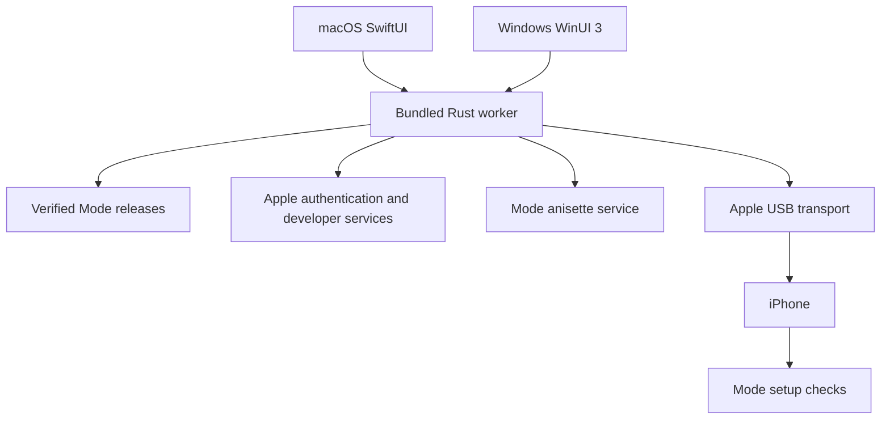

# Mode Setup for macOS and Windows

Implementation proposal. This document records the agreed desktop setup plan;
it does not mean the companion applications have been implemented.

## 1. Product and research conclusions

Build a desktop companion that installs the latest compatible Mode release,
signs it with the user's Apple developer identity, prepares the iPhone for phone
control, and verifies that Mode works independently of the computer.

### Decisions confirmed

- Launch macOS and Windows together.
- Native SwiftUI on Mac; native WinUI 3 on Windows.
- Shared Rust setup engine.
- Support free and paid Apple developer accounts.
- Bundle tested IPAs and offer verified downloads of newer releases.
- Free-account renewal happens through the desktop companion.
- Operate a Mode-hosted anisette-v3 service.
- Remember Apple login credentials only when the user explicitly opts in.

### Important constraints

- Free Personal Teams have seven-day provisioning, device/App-ID limits, and a
  three-app installation limit. Show the actual expiry returned by Apple.
  [Apple account limits](https://developer.apple.com/help/account/basics/about-your-developer-account)
- Computer trust, Developer Mode, developer-app trust where required, and VPN
  authorization need actions on the iPhone. Developer Mode includes a restart and
  confirmation; the app must guide and resume around these steps.
  [Apple Developer Mode](https://developer.apple.com/documentation/xcode/enabling-developer-mode-on-a-device)
- The provisioning profile belongs **inside the signed app**. Mode's
  `mode.rppairing` file and the VPN configuration are separate setup items.
- Being signed into iCloud does not automatically authorize developer signing.
  Provide Apple-account authentication and 2FA inside the companion; do not
  extract credentials from iCloud or Xcode.
- Mode's current paid build includes its VPN extension; its free build uses
  LocalDevVPN. Preserve those two supported variants.

### Open-source foundation

| Project | Planned use |
|---|---|
| [iLoader](https://github.com/nab138/iloader) | Reference for account login, provisioning, installation progress, and recovery UX. |
| [isideload](https://github.com/nab138/isideload) | Authentication, certificates, developer teams, provisioning, and signing primitives behind our adapter. |
| [idevice](https://github.com/jkcoxson/idevice) | USB discovery, device services, installation, file transfer, remote pairing, and developer-service access. |
| [idevice_pair](https://github.com/jkcoxson/idevice_pair) | Reference for pairing validation, wireless debugging, and copying pairing records into app containers. |
| [anisette-v3-server](https://github.com/Dadoum/anisette-v3-server) | Candidate for the isolated Mode-hosted authentication-support service. |
| [pymobiledevice3](https://github.com/doronz88/pymobiledevice3) | Protocol and diagnostics reference for Developer Mode and personalized developer disk images. |

Do not fork an entire desktop application. Pin dependencies, retain notices,
audit transitive licenses, and keep Mode branding separate. `isideload` explicitly
identifies entitlement handling as unfinished, so Mode-specific extension signing
is a required integration task.
[Upstream limitation](https://github.com/nab138/isideload#todo)

## 2. Architecture and interfaces

### Desktop separation

- Add `desktop/macos`, `desktop/windows`, and `native/mode-setup`.
- The Rust worker owns setup state, signing, downloads, device operations, and
  recovery. UI layers render its state and collect user input.
- Run the worker as a bundled child process over private stdin/stdout pipes. Use
  a versioned JSON command/event protocol, keeping credentials out of command-line
  arguments and logs.
- Keep the existing iPhone `modecore` dependency pin isolated. Do not globally
  upgrade its private-protocol implementation merely to satisfy desktop
  dependencies.

### Worker interface

Commands cover device discovery, preflight, Apple login, 2FA response, team
selection, install, refresh, update, repair, verification, cancellation, and
diagnostics export.

Events expose:

- Operation ID, selected device and installation identity.
- Current stage and progress.
- Required user action.
- Structured error with a recovery action.
- Installed version, signing expiry, and verification results.

Use one active mutating operation per device. Cancellation stops at safe
boundaries; never interrupt a device installation halfway through its final
commit.

### Storage

- Store passwords, session material, certificates/private keys, and pairing
  records through macOS Keychain or Windows protected credential storage.
- Temporary credentials remain in memory unless "Remember on this computer" is
  selected.
- Store only non-secret operation checkpoints and installation metadata in
  ordinary app storage.
- Scope records by Apple account, developer team, device, and effective bundle ID.
- Never automatically revoke certificates used by other tools.

### Hosted services

- Serve signed release manifests and immutable artifacts.
- Run anisette-v3 separately behind TLS with abuse controls and operational
  monitoring.
- Apple passwords, verification codes, certificates, and pairing records never
  pass through Mode's servers.
- Verify the chosen anisette implementation's license and operational behavior
  before deployment; repository availability alone is insufficient.

## 3. Installation, signing, and verification flow

### A. Detect and prepare

1. Discover connected iPhones; require explicit selection when several are
   connected.
2. Detect USB transport, lock state, computer trust, iOS compatibility, free
   storage, and Developer Mode.
3. On Windows, detect Apple Mobile Device transport/service availability. Use the
   Apple iTunes dependency path documented by iLoader for the initial supported
   configuration; validate Apple Devices installations separately before
   advertising compatibility.
   [iLoader prerequisites](https://github.com/nab138/iloader#how-to-use)
4. Guide trust and Developer Mode actions, then reconnect to the same device after
   restart.
5. Recheck actual state before resuming; a saved checkpoint never implies a device
   action succeeded.

### B. Authenticate and select the installation

1. Authenticate directly with Apple using anisette support and interactive 2FA.
2. List developer teams and identify free versus paid membership.
3. Show the selected Mode version, signing team, capabilities, expiry
   implications, and required phone actions.
4. Choose the free or paid IPA from the verified manifest.
5. Inspect the existing installation before making changes.

Keep bundle identifiers stable across refreshes. For new users, allocate a
deterministic team-scoped identifier and preserve extension suffixes. Existing
compatible installations retain their established identifiers.

Changing teams or identifiers is a separate migration: warn about data/Keychain
implications and require an explicit migration flow. Never silently uninstall an
existing Mode installation.

### C. Provision and sign

- Reuse a valid locally held certificate/private-key pair; otherwise create one
  with Apple.
- Register the device and required App IDs.
- Request profiles for the main app and each extension.
- Rewrite bundle identifiers and identity-dependent entitlements consistently.
- Sign nested executable bundles before the containing application, embedding the
  correct profiles.
- Validate signed entitlements against profile permissions before installation.
- Preserve the widget and paid VPN capabilities; never silently strip
  functionality to make signing pass.
- If a paid team cannot authorize the VPN capability, report the restriction and
  offer the free/external-VPN variant explicitly.

### D. Install and configure phone control

- Install or update over USB without deleting application data.
- Confirm the installed app's effective identifier and version through device
  services.
- Create or validate the remote-pairing record using Mode's expected host
  identity.
- Transfer `mode.rppairing` through House Arrest/AFC to the effective Mode
  container; read it back to verify transfer.
- Enable wireless debugging where supported and verify it.
- Prepare and personalize the compatible developer disk image.

Developer disk-image delivery is a release gate: establish a supported
acquisition path and applicable distribution rights before bundling or hosting
Apple assets. Support a user-selected lawful local image as a diagnostic
fallback. Do not ship an unverified public mirror as the production dependency.

Extend Mode to read prepared developer-image assets from its protected
application storage, allowing later repair without rebuilding the IPA.

### E. Verify readiness inside Mode

Installation success and phone-control readiness are separate results.

Add a narrowly scoped setup handshake: the desktop writes a versioned request
with an operation nonce into Mode's Documents; the foreground app consumes it and
writes a correlated result. It can request only setup diagnostics—not arbitrary
tasks.

Checks include:

- Pairing record parses and authenticates.
- Developer services and disk image are available.
- Required VPN route works from the iPhone.
- A screenshot can be captured.
- The existing hands check opens Settings, performs its test, and returns to Mode.

Paid users approve Mode's VPN configuration. Free users receive a guided
LocalDevVPN installation/opening flow; do not attempt to sign that third-party
app with Mode's certificate.

The desktop must release its developer-control session before the phone test.
Complete physical validation with the cable unplugged, so a successful USB
connection cannot conceal a broken on-phone route.

## 4. Native UI, updates, and renewal

### Design system

Extend the existing SwiftUI `ModeDesignSystem` for macOS, separating UIKit-specific
typography and appearance code behind platform implementations.

Create a shared token source for colors, typography, spacing, radii, and semantic
states. Generate Swift and WinUI resources from it; preserve existing mobile
values. Windows reproduces the same Mode component hierarchy and styling using
native controls.

### Screens

1. **Welcome:** install Mode, connect your iPhone.
2. **Device:** detected device, trust/unlock instructions, prerequisite checks.
3. **Apple account:** login, 2FA, team selection, optional remember checkbox.
4. **Install:** version summary and a stage list covering signing, installation,
   pairing, developer services, and verification.
5. **On your iPhone:** one clear action at a time, with automatic progress
   detection where possible.
6. **Ready:** installed version, verification status, signing expiry, Open Mode.
7. **Device dashboard:** Update, Refresh signing, Repair setup, Diagnostics,
   Forget account.

Use the mobile app's cards, step rows, status treatments, typography, and
light/dark styling. Include keyboard navigation and accessible progress
announcements.

### Release and refresh behavior

- Bundle tested free and paid IPAs with every desktop release.
- Check a signed manifest for newer compatible artifacts; verify signatures and
  hashes before unpacking or signing.
- Keep the selected release fixed throughout an operation.
- Treat app updates and signing refresh as separate operations.
- Refresh preserves the app's identifier, team, data, and valid pairing record.
- Display expiry from the actual provisioning profile; provide reminders before
  expiry.
- V1 refresh is user-triggered with the phone connected. No on-phone signer or
  unattended background refresh daemon.
- A failed refresh leaves the existing installation in place; never uninstall as
  a recovery shortcut.

## 5. Delivery gates and acceptance tests

### Milestone 1 — Signing and device proof

Before building the full UI, prove the Rust engine on macOS and Windows:

- Apple login and 2FA.
- Free-account installation including the widget.
- Paid-account installation including widget and VPN extension.
- Profile/entitlement validation and installed identity discovery.
- Pairing transfer, developer-image preparation, and independent phone control.

Failure of a gate produces a specific adapter fix or documented compatibility
restriction before proceeding.

### Milestone 2 — Native companions

Implement both shells against the same command/event fixtures, the design-system
adapters, resumable setup, and the device dashboard.

### Milestone 3 — Releases and repair

Add verified artifact delivery, refresh, expiry reminders, diagnostic export, and
platform installers. Sign/notarize the Mac app and sign the Windows installer and
worker.

### Required scenarios

- Fresh free and paid accounts on both operating systems.
- Existing Mode update and signing refresh without losing conversations, memory,
  settings, or provider credentials.
- Wrong password, invalid/expired 2FA, missing agreements, team restrictions, and
  certificate/App-ID exhaustion.
- Locked device, rejected trust, missing Windows transport, unplug/replug, and
  Developer Mode restart.
- Expired/revoked profiles, invalid pairing, missing/incompatible disk images, VPN
  denial, and mobile-data connection failure.
- Interrupted download/signing/install, app restart, stale verification reports,
  corrupt artifacts, and multiple connected phones.
- Physical test after unplugging, after rebooting, and after the free profile
  expires.
- Diagnostic exports contain no credentials, pairing records, private keys, or
  raw authentication responses.

### Defaults and boundaries

- Develop in `codex-changes`; do not merge unrelated feature branches as part of
  implementing this proposal.
- Initial desktop targets: macOS 26+ on supported Intel/Apple Silicon machines,
  and Windows 11 x64.
- Derive supported iPhone/iOS combinations from physical validation and publish
  them in the compatibility manifest.
- Desktop users need no Xcode, Rust, Python, or command-line setup.
- "Ready" requires the on-phone check; "Installed" alone is not sufficient.
- The computer is unnecessary for ordinary Mode tasks after setup, but
  free-account renewal still requires it.
